# UT1 · Fundamentos de Flutter

Apuntes de Desarrollo de Interfaces (2º DAM 2026-2027). Siguen el orden del temario oficial (*UT 1 Fundamentos de Flutter*, **8 sesiones**), añaden mis notas de clase del 17/09 y el 18/09/2026 e integran cada actividad de la carpeta (1.6, 1.7, 1.9 a 1.13) en la sesión a la que pertenece.

> ✏️ **Corrección** = algo que quedó mal apuntado o programado · ➕ **Ampliación** = no está en el temario, pero ayuda · ⏳ **Pendiente** = actividad sin terminar en el repo.

> 🖼️ Las imágenes de la carpeta `img/` son **capturas reales** de Flutter 3.47 (Material 3).

## Índice

1. [Sesión 1 · Qué es Flutter](#sesion-1-que-es-flutter)
2. [Sesión 2 · Anatomía de una app Flutter](#sesion-2-anatomia-de-una-app-flutter)
3. [Sesión 3 · Widgets básicos y composición](#sesion-3-widgets-basicos-y-composicion)
4. [Sesión 4 · Repaso: construir interfaces combinando widgets](#sesion-4-repaso-construir-interfaces-combinando-widgets)
5. [Sesión 5 · Layout y distribución de widgets](#sesion-5-layout-y-distribucion-de-widgets) (actividades 1.6, 1.12 y 1.13)
6. [Sesión 6 · Propiedades y personalización](#sesion-6-propiedades-y-personalizacion) (actividad 1.7)
7. [Sesión 7 · Eventos, callbacks y gestión del estado](#sesion-7-eventos-callbacks-y-gestion-del-estado) (actividades 1.9 y 1.10)
8. [Sesión 8 · Navegación entre pantallas](#sesion-8-navegacion-entre-pantallas) (actividad 1.11)
9. [Buenas costumbres](#buenas-costumbres-ampliacion)
10. [Chuleta de widgets](#chuleta-de-widgets)
11. [Preguntas para repasar](#preguntas-para-repasar)

| Actividad | Carpeta | Sesión | Estado |
|---|---|---|---|
| 1.6 Layout de un perfil | `actividad_1.6/construccion_del_layout_de_una_interfaz` | 5 | ✅ |
| 1.7 Personalización (reproductor) | `actividad_1.7/personalizacion_de_interfaces_con_flutter` | 6 | ✅ |
| 1.9 Gestión de estados (10 ejercicios) | `actividad_1.9/gestionar_estados` | 7 | 🟡 hechos 1.9.1 y 1.9.10 |
| 1.10 Tarjeta de presentación | `actividad_1.10/tarjeta_de_presentacion` | 7 | ⏳ `main.dart` de plantilla |
| 1.11 Navegación (3 ejercicios) | `actividad_1.11/navegacion_en_flutter` | 8 | 🟡 hecho 1.11.1 |
| 1.12 Varios (3 pantallas) | `actividad_1.12/varios` | 5 y 6 | ✅ |
| 1.13 Dibujar con layouts (5 dibujos) | `actividad_1.13/dibujar_con_layouts` | 5 y 6 | 🟡 hechos 1.13.1 a 1.13.3 |

---

## Sesión 1 · Qué es Flutter

### 1.1 Interfaz gráfica (GUI)

Hasta ahora hemos programado en distintos lenguajes, pero en este módulo el objetivo es otro: **aprender a construir interfaces gráficas de usuario**.

Una **GUI** (*Graphical User Interface*) es **la parte visual de una aplicación con la que interactúa el usuario**: pantallas, textos, imágenes, botones, campos de entrada, menús, listas… La primera decisión es **qué tecnología usamos** para construirlas.

### 1.2 Desarrollo nativo y multiplataforma

Si queremos una app para **Android y para iOS** tenemos dos caminos:

**Desarrollo nativo:** una app distinta para cada plataforma, con su tecnología propia.

```
              NUESTRA APP
                   │
          ┌────────┴────────┐
          ▼                 ▼
       ANDROID             iOS
     Kotlin / Java        Swift
          │                 │
          ▼                 ▼
   App para Android    App para iOS
```

- ✅ Aprovecha directamente las características de cada sistema operativo.
- ❌ Hay que **desarrollar y mantener código específico** para cada plataforma.

**Desarrollo multiplataforma:** un solo proyecto que comparte gran parte del código.

```
              UN PROYECTO
                   │
      Tecnología multiplataforma
          ┌────────┴────────┐
          ▼                 ▼
       ANDROID             iOS
```

- ✅ Se **comparte la mayor parte del código**.
- Las dos tecnologías más conocidas son **React Native** y **Flutter**.

### 1.3 React Native y Flutter

**React Native:** framework de código abierto que usa **React con JavaScript o TypeScript**. La interfaz se construye con **componentes**, que pueden contener otros componentes:

```jsx
<View>
  <Text>Hola</Text>
  <Button title="Aceptar" />
</View>
```

```
View
├── Text    "Hola"
└── Button  "Aceptar"
```

**Flutter:** **SDK** multiplataforma (de Google) que permite construir apps para distintas plataformas **a partir de una misma base de código**. Usa el lenguaje **Dart** y la interfaz se construye con **widgets**:

```dart
Column(
  children: [
    Text('Hola'),
    ElevatedButton(
      onPressed: () {},
      child: Text('Aceptar'),
    ),
  ],
)
```

```
Column
├── Text  "Hola"
└── ElevatedButton
    └── Text  "Aceptar"
```

Esta estructura se llama **árbol de widgets** (*Widget Tree*).

> 💡 **Idea importante:** en Flutter construimos las interfaces **combinando widgets**. Un widget puede contener otros widgets y así vamos formando un árbol.

### 1.4 Flutter y React Native: dos alternativas válidas

Persiguen objetivos parecidos con tecnologías distintas:

| Característica | Flutter | React Native |
|---|---|---|
| Lenguaje principal | **Dart** | JavaScript / TypeScript |
| La UI se construye con | **Widgets** | Componentes |
| Modelo de interfaz | Declarativo | Declarativo |
| Android | Sí | Sí |
| iOS | Sí | Sí |
| Hot Reload / actualización rápida al desarrollar | Sí | Sí |
| Crear componentes propios | Sí | Sí |

> **React Native no es una alternativa "peor" que Flutter.** La elección depende del proyecto, del equipo y de las tecnologías que ya conozca. Para una empresa con un equipo experto en React y TypeScript, React Native es una elección muy razonable. (React Native lo veréis en **PMDM**, UT2).

### 1.5 ¿Por qué Flutter en este módulo?

El objetivo de Desarrollo de Interfaces **no es aprender una tecnología concreta**, sino **entender cómo se construye, organiza y modifica una interfaz gráfica**. Flutter deja ver muy claro esa construcción:

```
INTERFAZ
   │
   ▼
ÁRBOL DE WIDGETS
   ├── WIDGETS      (qué hay)
   ├── PROPIEDADES  (cómo es)
   └── EVENTOS      (qué pasa al interactuar)
```

Lo que iremos aprendiendo, en orden:

```
usar widgets → organizarlos → modificar sus propiedades → responder a eventos
→ gestionar el estado → crear nuestros propios widgets → construir aplicaciones completas
```

Más adelante también se trabajará con **sensores, cámara, localización, voz** y otras formas de interacción.

- ❌ Elegir Flutter **no** significa «Flutter es mejor que React Native».
- ✅ Significa «Flutter es especialmente adecuado para los objetivos de este módulo».

### 1.6 Flutter es **declarativo**

Imagina una app con **modo claro y modo oscuro** controlada por una variable:

```dart
bool modoOscuro = false;
```

```
modoOscuro = false                    modoOscuro = true
┌─────────────────────────┐          ┌─────────────────────────┐
│      MI APLICACIÓN      │          │      MI APLICACIÓN      │
│      Hola, usuario      │   ──►    │      Hola, usuario      │
│    [ MODO OSCURO ]      │          │     [ MODO CLARO ]      │
└─────────────────────────┘          └─────────────────────────┘
 Fondo claro · texto oscuro           Fondo oscuro · texto claro
```

Al pulsar el botón, `modoOscuro` pasa a `true` y todo debe cambiar.

**Modelo imperativo:** le dices al programa **qué cambios hacer, paso a paso**, sobre los elementos que ya existen:

```
Cambia el fondo a oscuro → cambia el título a blanco → cambia el texto a blanco
→ cambia el aspecto del botón → cambia el texto del botón
```

**Modelo declarativo (Flutter):** describes **cómo debe ser la interfaz para el estado actual** y Flutter se encarga de redibujarla:

```
modoOscuro = false  ──►  INTERFAZ CLARA
modoOscuro = true   ──►  INTERFAZ OSCURA
```

Tú solo cambias **el estado** (la variable) y la interfaz se actualiza sola. Se resume así:

```
INTERFAZ = f(estado)
```

La interfaz que vemos **depende del estado actual** de la aplicación: mismo estado, misma interfaz.

| | Imperativo | Declarativo |
|---|---|---|
| Qué escribes | **Los cambios** que hay que hacer | **Cómo debe ser** la interfaz para cada estado |
| Quién actualiza la pantalla | Tú, paso a paso | El framework |

React Native también es declarativo; no es algo exclusivo de Flutter.

### 1.7 En Flutter casi todo es un widget

Los **widgets** son los bloques con los que se construye la interfaz. Hay dos tipos:

- **Representan elementos visibles:** `Text` (texto), `Image` (imagen), `Icon` (icono), `ElevatedButton` (botón).
- **Organizan a otros widgets:** `Column` (en vertical), `Row` (en horizontal)…

```
Column                       Row
├── 👤                       [ EDITAR ] [ SALIR ]
├── Laura Pérez
├── laura@email.com
└── 2.º DAM
```

Combinándolos se forma el árbol:

```
Column
├── Icon
├── Text
├── Text
└── Row
    ├── ElevatedButton
    └── ElevatedButton
```

### 🎯 Qué hemos aprendido en la sesión 1

| Concepto | Qué es |
|---|---|
| **GUI** | La parte gráfica de una app mediante la que interactuamos con ella |
| **Desarrollo multiplataforma** | Desarrollar apps para varias plataformas compartiendo buena parte del código |
| **Flutter** | El SDK multiplataforma que usaremos en el módulo |
| **React Native** | Otra tecnología multiplataforma válida (React + JavaScript/TypeScript) |
| **Modelo declarativo** | Describir cómo debe ser la interfaz para el estado actual, en vez de programar cada modificación |
| **Widget** | Cada uno de los bloques con los que construimos una interfaz Flutter |
| **Árbol de widgets** | La estructura jerárquica que forman los widgets al contener unos a otros |

```
INTERFAZ VISUAL  ↕  ÁRBOL DE WIDGETS  ↕  CÓDIGO DART
```

Hay que saber **pasar de una representación a otra** en cualquier dirección.

---

## Sesión 2 · Anatomía de una app Flutter

### 2.1 La app mínima

```dart
import 'package:flutter/material.dart';  // Trae los widgets de Material Design

void main() {
  runApp(
    MaterialApp(
      home: Scaffold(
        body: Center(
          child: Text('Hola Flutter'),
        ),
      ),
    ),
  );
}
```

Aparecen piezas que aún no conocemos: `main()`, `runApp()`, `MaterialApp`, `Scaffold`… Vamos a ver qué hace cada una y cómo se relaciona el código con lo que sale en pantalla.

### 2.2 Cómo leer el código: mayúsculas y minúsculas

*(De mis notas de clase)*

- Lo que empieza por **Mayúscula** es un **widget** (una clase): `Scaffold`, `Center`, `Text`…
- Lo que empieza por **minúscula** seguido de `:` es una **propiedad** (un parámetro con nombre): `home:`, `body:`, `child:`…

```dart
Icon(              // Widget
  Icons.school,    // Primer parámetro: qué icono
  size: 60,        // Propiedad
)
```

### 2.3 Pieza a pieza

**`main()`: el punto de partida.** Todo programa necesita un sitio por el que empezar. Al ejecutar, Dart busca `main()` y ejecuta sus instrucciones:

```
Ejecutamos el programa → main() → 💡 comienza la aplicación
```

`main()` es **de Dart, no de Flutter**: también existe en programas Dart sin interfaz (igual que el `main` de Java).

**`runApp()`: arranca Flutter.** Es una **función de Flutter** que recibe un widget y lo coloca como **punto de partida (raíz) de la interfaz**. `runApp(MaterialApp(...))` se lee como *"inicia la app usando `MaterialApp` como widget raíz"*.

```
main()
 └── runApp()
      └── MaterialApp
```

**`MaterialApp`: la aplicación.** Configura la **app entera** con el estilo **Material Design** de Google. Más adelante servirá para aspectos generales (tema, colores, navegación…). De momento usamos una propiedad:

- **`home:`** → la **pantalla inicial**: al arrancar se muestra lo que pongamos aquí.

**`Scaffold`: la estructura de una pantalla.** Las apps móviles tienen zonas habituales (barra arriba, contenido, botones…). `Scaffold` es el **esqueleto de una pantalla** con esos huecos preparados:

```
┌──────────────────────────────┐
│            AppBar            │  ← appBar:   barra superior
├──────────────────────────────┤
│                              │
│             body             │  ← body:     contenido principal
│                              │
│                         [ + ]│  ← floatingActionButton: botón flotante
└──────────────────────────────┘
```

En la primera app solo usamos `body`: todo lo que pongamos ahí aparece en la zona principal.

> ✏️ **Corrección:** en mis notas puse "configura la aplicación en Material Design" al lado de `Scaffold`. Eso lo hace **`MaterialApp`**. `Scaffold` es la estructura de **una pantalla**.

### 2.4 Seguir el código hasta la pantalla

```
main()
 └── runApp()
      └── MaterialApp
           └── Scaffold
                └── Center
                     └── Text  "Hola Flutter"
```

Resultado: "Hola Flutter" centrado en la pantalla.

> **Hay una relación directa entre la estructura del código y la estructura de la interfaz.** La interfaz se construye combinando widgets que forman una jerarquía.

### 2.5 Añadir una barra superior

```dart
Scaffold(
  appBar: AppBar(
    title: Text('Mi primera app'),
  ),
  body: Center(
    child: Text('Hola Flutter'),
  ),
)
```

```
Scaffold
├── appBar ──► "Mi primera app"   (barra arriba)
└── body   ──► "Hola Flutter"     (centro)
```

```
┌──────────────────────────────┐
│        Mi primera app        │
├──────────────────────────────┤
│                              │
│         Hola Flutter         │
│                              │
└──────────────────────────────┘
```

Fíjate en que **no hemos dibujado ninguna barra**. Solo hemos dicho que el `Scaffold` *tiene* un `AppBar` y Flutter la construye (otra vez la idea **declarativa**).

> ➕ **Ampliación:** el botón `[ + ]` se pone así:
>
> ```dart
> Scaffold(
>   floatingActionButton: FloatingActionButton(
>     onPressed: () {},
>     child: Icon(Icons.add),
>   ),
> )
> ```

### 2.6 La interfaz y el código están relacionados

Ya podemos leer una app sencilla **en las dos direcciones**:

- Del **código** a la **interfaz**: viendo

  ```dart
  Scaffold(
    appBar: AppBar(title: Text('Mi aplicación')),
    body: Center(child: Text('Bienvenido')),
  )
  ```

  imaginamos una pantalla con la barra «Mi aplicación» y «Bienvenido» en el centro.
- De la **interfaz** al **código**: viendo esa pantalla pensamos *"`Scaffold` + `AppBar` + `Center` + `Text`"*.

```
INTERFAZ VISUAL  ↔  ESTRUCTURA DE WIDGETS  ↔  CÓDIGO DART
```

### 🎯 Resumen de la sesión 2

```
main()
 └── runApp()
      └── MaterialApp
           └── Scaffold
                ├── appBar
                └── body
```

| Elemento | Función |
|---|---|
| `main()` | Punto de entrada del programa Dart |
| `runApp()` | Arranca la interfaz Flutter con un widget raíz |
| `MaterialApp` | Configura la aplicación con Material Design |
| `home` | Pantalla inicial |
| `Scaffold` | Estructura básica de una pantalla |
| `appBar` | Barra superior |
| `body` | Contenido principal |

> **Lo que ves en pantalla es el resultado de un árbol de widgets escrito en código.**

---

## Sesión 3 · Widgets básicos y composición

Algunos widgets **muestran contenido**, otros **permiten hacer acciones** y otros **agrupan y organizan** a los demás. En esta sesión aprendemos a elegirlos y combinarlos.

### 3.1 `child` y `children`

Es **la distinción más importante** para construir interfaces.

**`child`: UN solo hijo.**

```dart
ElevatedButton(
  onPressed: () {},
  child: Text('ACEPTAR'),
)
```

```
ElevatedButton
└── Text
```

**`children`: VARIOS hijos** (una lista entre corchetes `[ ]`).

```dart
Column(
  children: [
    Icon(Icons.person),
    Text('Harry Potter'),
    Text('harry@email.com'),
  ],
)
```

```
Column
├── Icon
├── Text
└── Text
```

```
child     → UN widget hijo
children  → VARIOS widgets hijos  [ ... ]
```

> ⚠️ Fíjate siempre en los **hijos directos**. Una `Card` con una `Column` de 3 textos dentro **tiene un solo hijo** (la `Column`), así que usa `child`, aunque en pantalla se vean 3 cosas.

### 3.2 `Column` y `Row`

| | `Column` | `Row` |
|---|---|---|
| Coloca a sus hijos | **Uno debajo de otro** ↓ | **Uno al lado de otro** → |
| Usa | `children` | `children` |

```dart
Column(                         Row(
  children: [                     children: [
    Icon(Icons.person),             Icon(Icons.email),
    Text('Harry Potter'),           Text('harry@email.com'),
    Text('harry@email.com'),      ],
  ],                            )
)
```

```
       👤                        ✉ harry@email.com
   Harry Potter
 harry@email.com
```

| `Column` | `Row` |
|---|---|
| 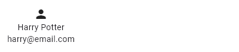 | 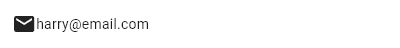 |

### 3.3 Anidar widgets

Un widget puede contener otros, y estos otros más. Así se construyen interfaces complejas (**componer** widgets):

```dart
Column(
  children: [
    Icon(Icons.person),
    Text('Harry Potter'),
    Text('Estudiante de DAM'),
    Row(
      children: [
        Icon(Icons.email),
        Text('harry@email.com'),
      ],
    ),
    ElevatedButton(
      onPressed: () {},
      child: Text('VER PERFIL'),
    ),
  ],
)
```

```
Column                 ← children: tiene varios hijos
├── Icon
├── Text
├── Text
├── Row                ← children: tiene varios hijos
│   ├── Icon
│   └── Text
└── ElevatedButton     ← child: tiene un solo hijo
    └── Text
```

### 3.4 Widgets básicos

| Widget | Para qué sirve | Ejemplo |
|---|---|---|
| `Text` | Mostrar texto | `Text('Harry Potter')` |
| `Icon` | Mostrar un icono | `Icon(Icons.school, size: 60)` |
| `Image` | Mostrar una imagen | `Image.network('https://...')` (de Internet; las del proyecto se verán más adelante) |
| `ElevatedButton` | Botón con relieve | `ElevatedButton(onPressed: () {}, child: Text('ACEPTAR'))` |
| `IconButton` | Botón que es solo un icono | `IconButton(onPressed: () {}, icon: Icon(Icons.favorite))` |
| `CircleAvatar` | Contenido dentro de un círculo (usuarios, perfiles) | `CircleAvatar(child: Icon(Icons.person))` |
| `Divider` | Línea para separar contenido | `Divider()` (sin hijos) |
| `Card` | Tarjeta que agrupa contenido relacionado | `Card(child: Column(...))` |
| `ListTile` | Fila ya montada con icono, título y subtítulo | ver abajo |

**Detalles importantes:**

- `onPressed: () {}` es una **función vacía**: el botón funciona pero de momento no hace nada (en la sesión 7 le daremos código). Con `onPressed: null` el botón sale **desactivado** (en gris).
- `IconButton` no usa `child`, usa **`icon:`**, una propiedad con nombre específico.
- `Divider` **no tiene hijos**: solo dibuja una línea. Por ejemplo, para separar dos bloques:

  ```dart
  Column(
    children: [
      Text('Datos personales'),
      Divider(),
      Text('Datos de contacto'),
    ],
  )
  ```

**Así se ven:**

| Widget | Render |
|---|---|
| `Text` |  |
| `Icon` |  |
| `ElevatedButton` | 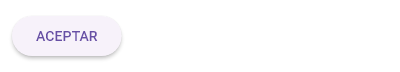 |
| `ElevatedButton (onPressed: null)` | 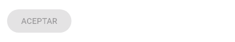 |
| `IconButton` | 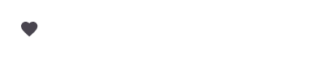 |
| `CircleAvatar` |  |
| `Divider` | 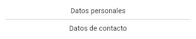 |
| `Card` | 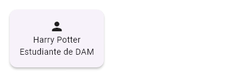 |
| `ListTile` |  |

### 3.5 `ListTile`: información organizada en una fila

Flutter incluye widgets que **ya combinan varios elementos** típicos. `ListTile` es uno de ellos:

```dart
ListTile(
  leading: Icon(Icons.email),           // al principio
  title: Text('Correo electrónico'),    // contenido principal
  subtitle: Text('harry@email.com'),    // contenido secundario
)
```

```
✉  Correo electrónico
   harry@email.com
```

| Propiedad | Zona |
|---|---|
| `leading` | Al principio (normalmente un icono o avatar) |
| `title` | Contenido principal |
| `subtitle` | Contenido secundario, debajo del título |
| `trailing` ➕ | Al final de la fila (p. ej. una flecha `Icons.chevron_right`; lo usa la 1.11.1) |

Se pueden combinar varios en una `Column`, separados con `Divider()`:

```dart
Column(
  children: [
    ListTile(
      leading: Icon(Icons.email),
      title: Text('Correo electrónico'),
      subtitle: Text('harry@email.com'),
    ),
    Divider(),
    ListTile(
      leading: Icon(Icons.phone),
      title: Text('Teléfono'),
      subtitle: Text('600 123 456'),
    ),
  ],
)
```

### 3.6 Construir una interfaz: primero la estructura

**No empieces escribiendo código.** El método es:

```
INTERFAZ → ¿QUÉ WIDGETS NECESITO? → ¿CÓMO SE RELACIONAN? → ÁRBOL DE WIDGETS → CÓDIGO
```

**Ejemplo:** pantalla de perfil.

```
          👤
      Laura Pérez
   Estudiante de DAM
────────────────────
✉  laura@email.com
☎  600 123 456
     [ VER PERFIL ]
```

1. **¿Qué widgets aparecen?** `CircleAvatar`, `Text`, `Text`, `Divider`, `ListTile`, `ListTile`, `ElevatedButton`.
2. **¿Cómo están organizados?** Todos uno debajo de otro, así que van en una `Column`.
3. **Árbol:**

```
Column
├── CircleAvatar
│   └── Icon
├── Text
├── Text
├── Divider
├── ListTile
├── ListTile
└── ElevatedButton
    └── Text
```

4. **Código:**

```dart
Column(
  children: [
    CircleAvatar(child: Icon(Icons.person)),
    Text('Laura Pérez'),
    Text('Estudiante de DAM'),
    Divider(),
    ListTile(
      leading: Icon(Icons.email),
      title: Text('laura@email.com'),
    ),
    ListTile(
      leading: Icon(Icons.phone),
      title: Text('600 123 456'),
    ),
    ElevatedButton(
      onPressed: () {},
      child: Text('VER PERFIL'),
    ),
  ],
)
```

### 🎯 Al terminar la sesión 3 debes saber

- Reconocer los widgets más habituales.
- Distinguir `child` de `children`.
- Combinar widgets con `Row` y `Column` y anidarlos.
- Interpretar un árbol de widgets.
- Pasar de una interfaz a su árbol, y del árbol al código.

---

## Sesión 4 · Repaso: construir interfaces combinando widgets

Es una sesión de **consolidación**: lo mismo que la 3, con más ejemplos y solo **siete widgets**.

### 4.1 `child` con `Center` y `Padding`

Un widget con un único hijo usa `child`:

```dart
Center(
  child: Text('Hola Flutter'),
)

Padding(
  padding: EdgeInsets.all(20),
  child: Text('Harry Potter'),
)
```

```
Center            Padding
└── Text          └── Text
```

### 4.2 `children`, `Column` y `Row`

`Column` y `Row` están **diseñados para varios hijos**: `children: [ ... ]`. `Column` coloca **de arriba abajo** y `Row` **de izquierda a derecha**:

```dart
Row(
  children: [
    Icon(Icons.phone),
    Text('Llamar'),
  ],
)
```

```
☎ Llamar          Row
                  ├── Icon
                  └── Text
```

> El **aspecto visual** y el **árbol de widgets** son dos formas de representar **la misma interfaz**.

### 4.3 Anidar: una `Row` de botones dentro de una `Column`

```dart
Column(
  children: [
    Icon(Icons.person),
    Text('Harry Potter'),
    Text('harry@email.com'),
    Row(
      children: [
        ElevatedButton(onPressed: () {}, child: Text('EDITAR')),
        ElevatedButton(onPressed: () {}, child: Text('SALIR')),
      ],
    ),
  ],
)
```

```
Column
├── Icon
├── Text
├── Text
└── Row                    ← children: varios hijos
    ├── ElevatedButton     ← child: un hijo
    │   └── Text
    └── ElevatedButton
        └── Text
```

### 4.4 Los siete widgets de estas horas

| Widget | Para qué sirve | Cómo se usa |
|---|---|---|
| `Text` | Mostrar texto | `Text('Harry Potter')` |
| `Icon` | Mostrar un icono | `Icon(Icons.school)` |
| `Image` | Mostrar una imagen de Internet | `Image.network('https://...')` |
| `ElevatedButton` | Mostrar un botón | `ElevatedButton(onPressed: () {}, child: Text('ACEPTAR'))` |
| `Column` | Organizar en vertical | `Column(children: [...])` |
| `Row` | Organizar en horizontal | `Row(children: [...])` |
| `Center` | Centrar un widget | `Center(child: ...)` |

### 4.5 Centrar dentro de una fila o columna

```dart
mainAxisAlignment: MainAxisAlignment.center
```

Centra los hijos **en el eje principal**:

- En una `Column` el eje principal es **vertical** ↕ → los centra en vertical.
- En una `Row` el eje principal es **horizontal** ↔ → los centra en horizontal.

Se explica a fondo en la sesión 5.

### Ejemplo de clase (17/09): tarjeta de Harry Potter

```dart
import 'package:flutter/material.dart';

void main() {
  runApp(
    MaterialApp(
      home: Scaffold(
        body: Center(
          child: Column(
            mainAxisAlignment: MainAxisAlignment.center,  // centrado en vertical
            children: [
              Icon(Icons.school, size: 60),
              Text('Harry Potter'),
              Text('harry@email.com'),
              Row(
                mainAxisAlignment: MainAxisAlignment.center,  // botones centrados en horizontal
                children: [
                  ElevatedButton(onPressed: () {}, child: Text('EDITAR')),
                  ElevatedButton(onPressed: () {}, child: Text('SALIR')),
                ],
              ),
            ],
          ),
        ),
      ),
    ),
  );
}
```

```
Center
└── Column
    ├── Icon (school)
    ├── Text ('Harry Potter')
    ├── Text ('harry@email.com')
    └── Row
        ├── ElevatedButton → Text ('EDITAR')
        └── ElevatedButton → Text ('SALIR')
```

Los dos botones salen pegados. Para separarlos, pon un `SizedBox(width: 16)` entre ellos (sesión 5).

---

## Sesión 5 · Layout y distribución de widgets

En Flutter **el layout también se hace con widgets**. Unos **muestran contenido** (`Text`, `Image`, `Icon`) y otros sirven para **organizar, dar tamaño o colocar** a otros widgets. Esta sesión responde a:

- ¿Cómo **centro** un elemento?
- ¿Cómo **separo** dos widgets?
- ¿Cómo hago que algo **ocupe el espacio libre**?
- ¿Cómo **reparto** elementos por la pantalla?
- ¿Cómo pongo un widget **encima de otro**?

### 5.1 Los dos ejes de `Row` y `Column`

Todo `Row` y toda `Column` tienen **dos ejes**:

- **Eje principal:** la dirección en la que coloca a sus hijos.
- **Eje transversal (cruzado):** el perpendicular.

```
ROW                                   COLUMN
         eje transversal ↓                     eje transversal →
  [ A ]   [ B ]   [ C ]                      [ A ]
  ─────────────────────→                     [ B ]
       eje principal                         [ C ]
                                               ↓ eje principal
```

| | `mainAxisAlignment` (eje principal) | `crossAxisAlignment` (eje transversal) |
|---|---|---|
| **Row** | Horizontal ↔ | Vertical ↕ |
| **Column** | Vertical ↕ | Horizontal ↔ |

> ⚠️ **Cuidado:** la **misma propiedad** controla una dirección distinta según sea `Row` o `Column`.

### 5.2 `mainAxisAlignment`: repartir en el eje principal

```dart
Row(
  mainAxisAlignment: MainAxisAlignment.center,
  children: [
    Icon(Icons.home),
    Icon(Icons.search),
    Icon(Icons.settings),
  ],
)
```

Sin la propiedad, los tres salen juntos al principio.

| Valor | Resultado |
|---|---|
| `start` (por defecto) | `[■][■][■]-------------------` |
| `center` | `----------[■][■][■]----------` |
| `end` | `-------------------[■][■][■]` |
| `spaceBetween` | `[■]----------[■]----------[■]` (sin hueco en los bordes) |
| `spaceAround` | `---[■]------[■]------[■]---` (en los bordes, la mitad de hueco) |
| `spaceEvenly` | `-----[■]-----[■]-----[■]-----` (todos los huecos iguales) |

**Render real** (`Row` con 3 cuadrados sobre fondo gris):

| Valor | Render |
|---|---|
| `start` | 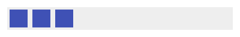 |
| `center` | 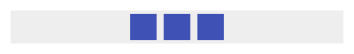 |
| `end` | 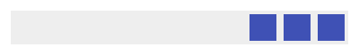 |
| `spaceBetween` | 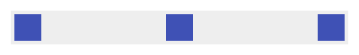 |
| `spaceAround` | 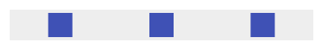 |
| `spaceEvenly` | 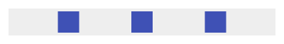 |

> ➕ **Ampliación: `mainAxisSize`.** Una `Column` ocupa por defecto **toda la altura disponible** (`MainAxisSize.max`). Con `mainAxisSize: MainAxisSize.min` mide **lo justo para sus hijos**. Lo usan la 1.12.2, la 1.13.1 (semáforo) y el ejemplo de navegación de la sesión 8, y en la UT2 se ve con Flutter Inspector.

### 5.3 `crossAxisAlignment`: el otro eje

```dart
Column(
  crossAxisAlignment: CrossAxisAlignment.start,  // todo pegado a la izquierda
  children: [
    Text('Laura Pérez'),
    Text('2.º DAM'),
    Text('Desarrollo de Interfaces'),
  ],
)
```

En una `Column` el eje transversal es **horizontal**, así que `start` coloca los textos **a la izquierda**.

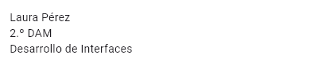

| Valor | Comportamiento |
|---|---|
| `CrossAxisAlignment.start` | Al **inicio** del eje transversal |
| `CrossAxisAlignment.center` | **Centrados** en el eje transversal (es el valor por defecto) |
| `CrossAxisAlignment.end` | Al **final** del eje transversal |
| `CrossAxisAlignment.stretch` | **Estira** los hijos para ocupar todo el espacio del eje transversal |

### 5.4 ¿Por qué unos tienen `child`, otros `children` y otros ninguno?

| Tipo | Propiedad | Widgets |
|---|---|---|
| Trabajan con **un** widget | `child` | `Center`, `Padding`, `Expanded`, `Card`, `SizedBox`, `Container`, `Positioned`, `ElevatedButton`, `CircleAvatar` |
| Organizan **varios** widgets | `children` | `Row`, `Column`, `Stack`, `Wrap` |
| **Son** el contenido | ninguna | `Text`, `Icon`, `Image`, `Divider` |
| Huecos con **función concreta** | nombre propio | `title`, `subtitle`, `leading` (ListTile), `icon` (IconButton), `appBar`, `body` (Scaffold) |

La documentación oficial de Flutter separa los widgets de layout en **de un solo hijo** (*single-child*) y **de varios hijos** (*multi-child*). `Text` no organiza a nadie: **él mismo es el contenido**.

```
child               → un hueco para un widget
children            → una lista de widgets
title, icon, leading… → huecos con una función concreta
```

### 5.5 `Center`: centrar

```dart
Center(
  child: Text('Hola Flutter'),
)
```

Coloca a su `child` **en el centro del espacio disponible**.

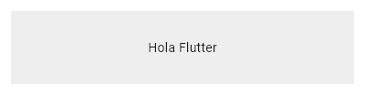

*(Fondo gris = el espacio disponible)*

### 5.6 `Padding`: espacio alrededor

```dart
Padding(
  padding: EdgeInsets.all(20),
  child: Text('Hola Flutter'),
)
```

Añade **espacio alrededor de su hijo**, por dentro.

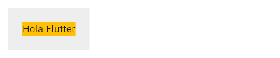

*(Gris = los 20 de padding · ámbar = el hijo)* Con **`EdgeInsets`** se dice cuánto espacio y en qué lados:

| Forma | Qué hace |
|---|---|
| `EdgeInsets.all(20)` | 20 en **los cuatro lados** |
| `EdgeInsets.symmetric(horizontal: 20, vertical: 10)` | 20 a izquierda y derecha, 10 arriba y abajo |
| `EdgeInsets.only(left: 20, top: 10)` | Solo en los lados que indiques |

### 5.7 `SizedBox`: tamaño fijo y separación

**Como hueco** (sin hijo), para separar widgets:

```dart
Column(
  children: [
    Text('Nombre'),
    SizedBox(height: 20),   // 20 de separación vertical
    Text('Correo'),
  ],
)
```

Usa `height` dentro de una `Column` y `width` dentro de una `Row`.

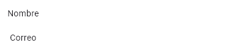

**Para dar tamaño** (con hijo), fuerza el tamaño de otro widget:

```dart
SizedBox(
  width: 200,
  height: 50,
  child: ElevatedButton(
    onPressed: () {},
    child: Text('ENTRAR'),
  ),
)
```

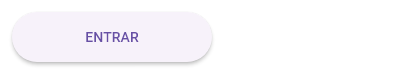

| Código | Resultado |
|---|---|
| `SizedBox(height: 20)` | Reserva 20 píxeles de alto |
| `SizedBox(width: 20)` | Reserva 20 píxeles de ancho |
| `SizedBox(width: 200, height: 50)` | Fija las dos dimensiones |
| `SizedBox(width: double.infinity)` | Pide **todo el ancho** disponible |
| `SizedBox(height: double.infinity)` | Pide **todo el alto** disponible |

**¿`CrossAxisAlignment.stretch` o `SizedBox(width: double.infinity)`?** En una `Column`, `stretch` estira **todos** los hijos en horizontal; `SizedBox(width: double.infinity)` estira **solo uno**. Para todos, `stretch`; para uno, `SizedBox`. (La 1.12.1 usa `stretch` para que los dos botones finales ocupen todo el ancho.)

### 5.8 `Expanded`: ocupar el espacio libre

Dentro de una `Row`, `Column` o `Flex`, `Expanded` hace que su hijo **se estire para ocupar el espacio que sobra**:

```dart
Row(
  children: [
    Text('Nombre'),
    Expanded(
      child: Text('Laura Pérez'),   // ocupa todo lo que queda de la fila
    ),
  ],
)
```

**Con varios `Expanded`** el espacio se **reparte a partes iguales**. Con **`flex`** se reparte en proporción:

```dart
Row(
  children: [
    Expanded(flex: 1, child: Text('A')),
    Expanded(flex: 2, child: Text('B')),
  ],
)
```

```
┌──────────┬────────────────────┐
│    A     │         B          │    B recibe el doble que A (1 : 2)
└──────────┴────────────────────┘
```

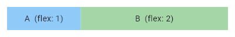

> ⚠️ `Expanded` **solo funciona dentro de `Row`, `Column` o `Flex`**. Fuera de ellos da error.

### 5.9 `Spacer`: espacio flexible

```dart
Row(children: [Text('Inicio'), SizedBox(width: 30), Text('Fin')])
// Inicio ←30→ Fin------------------------

Row(children: [Text('Inicio'), Spacer(), Text('Fin')])
// Inicio-------------------------------Fin
```

| | Tipo de espacio | Cuándo |
|---|---|---|
| `SizedBox` | **Fijo** ("quiero 30 de hueco") | Separar elementos una cantidad concreta |
| `Spacer` | **Flexible** ("todo el espacio que sobre") | Empujar elementos a los extremos |

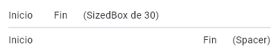

`Spacer` está pensado precisamente como la forma sencilla de meter espacio flexible en un `Flex`, `Row` o `Column`.

### 5.10 `Stack`: unos encima de otros

`Row` coloca uno al lado del otro y `Column` uno debajo del otro. **`Stack` los superpone como capas**: el primero de la lista queda al fondo y el último, encima. Flutter lo define como un layout para **solapar hijos**.

```dart
Stack(
  children: [
    Image.network('...'),       // capa de abajo
    Icon(Icons.favorite),       // capa de encima
  ],
)
```

### 5.11 `Positioned`: colocar dentro de un `Stack`

Sirve para decir **dónde** va un elemento dentro del `Stack`:

```dart
Stack(
  children: [
    Image.network('...'),
    Positioned(
      top: 10,       // 10 desde arriba
      right: 10,     // 10 desde la derecha
      child: Icon(Icons.favorite),
    ),
  ],
)
```

```
┌──────────────────────────────┐
│                         ♥    │ ← top 10, right 10
│          IMAGEN              │
└──────────────────────────────┘
```

Propiedades: `top`, `bottom`, `left`, `right`.


**`Positioned.fill()`** es una variante que **estira el widget hasta ocupar todo el `Stack`**. Es muy útil para poner una imagen o un fondo sobre el que superponer otros elementos.

> **¿Por qué `Stack` usa `children` y `Positioned` usa `child`?** Porque `Stack` organiza **varios** elementos y cada `Positioned` coloca **uno** concreto.

### 5.12 `Wrap`: cuando no cabe

Con una `Row`, si los elementos no caben en horizontal hay **desbordamiento** (*overflow*: Flutter pinta una franja amarilla y negra). `Wrap` **continúa en la línea siguiente**:

```
[HTML] [CSS] [Flutter] [Dart]
[Python] [Java]
```

```dart
Wrap(
  spacing: 8,      // separación entre elementos
  runSpacing: 8,   // separación entre líneas
  children: [
    Chip(label: Text('HTML')),
    Chip(label: Text('CSS')),
    Chip(label: Text('Flutter')),
    Chip(label: Text('Dart')),
  ],
)
```

`Chip` es una "etiqueta" pequeña con bordes redondeados.

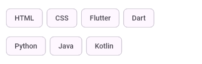

> ✏️ **Corrección:** en mis notas puse "Warp". El widget se llama **`Wrap`** (envolver).

### 5.13 `Container`: el todoterreno

Combina en un solo widget **tamaño, padding, margen, fondo, bordes, decoración y un `child`** (la documentación lo llama *widget de conveniencia*):

```dart
Container(
  width: 250,
  padding: EdgeInsets.all(16),   // espacio POR DENTRO
  margin: EdgeInsets.all(10),    // espacio POR FUERA
  child: Text('Desarrollo de Interfaces'),
)
```

| | `margin` | `padding` |
|---|---|---|
| Dónde | **Fuera** del widget (lo separa de los demás) | **Dentro** (entre el borde y el contenido) |

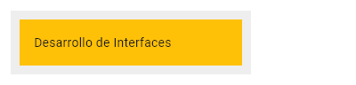

*(Gris = margin · ámbar = padding + contenido)* La decoración (`decoration: BoxDecoration(...)`) se ve en la sesión 6.

> ⚠️ **Que `Container` pueda hacerlo todo no significa que haya que usarlo para todo.** Usa el widget específico, porque el código expresa mejor qué quieres conseguir:
>
> - ¿Solo espacio alrededor? → `Padding`
> - ¿Solo un hueco fijo? → `SizedBox`
> - ¿Solo centrar? → `Center`

### 5.14 Construir un layout: pensar antes de programar

Antes de escribir código, mira la interfaz y hazte estas preguntas **en orden**:

```
1. ¿Vertical u horizontal?               → Column / Row
2. ¿Qué elementos van agrupados?         → Card, Row/Column anidadas
3. ¿Hay que separar elementos?           → SizedBox, Padding, Divider
4. ¿Alguno ocupa el espacio libre?       → Expanded, Spacer
5. ¿Hay elementos superpuestos?          → Stack + Positioned
```

**Ejemplo:** tarjeta de Hermione.

```
┌────────────────────────────────────┐
│  👤  Hermione Granger              │
│      Estudiante de DAM             │
│  ────────────────────────────────  │
│  ✉  hermione@hogwarts.edu          │
│  [ VER PERFIL ]               ♥    │
└────────────────────────────────────┘
```

Árbol:

```
Card
└── Padding
    └── Column
        ├── Row
        │   ├── CircleAvatar
        │   ├── SizedBox
        │   └── Column
        │       ├── Text
        │       └── Text
        ├── Divider
        ├── ListTile
        └── Row
            ├── ElevatedButton
            ├── Spacer
            └── IconButton
```

Código (el temario solo da el árbol; este es el código que le corresponde):

```dart
Card(
  child: Padding(
    padding: EdgeInsets.all(16),
    child: Column(
      children: [
        Row(
          children: [
            CircleAvatar(child: Icon(Icons.person)),
            SizedBox(width: 16),
            Column(
              crossAxisAlignment: CrossAxisAlignment.start,  // textos alineados a la izquierda
              children: [
                Text('Hermione Granger'),
                Text('Estudiante de DAM'),
              ],
            ),
          ],
        ),
        Divider(),
        ListTile(
          leading: Icon(Icons.email),
          title: Text('hermione@hogwarts.edu'),
        ),
        Row(
          children: [
            ElevatedButton(onPressed: () {}, child: Text('VER PERFIL')),
            Spacer(),                                   // empuja el corazón a la derecha
            IconButton(onPressed: () {}, icon: Icon(Icons.favorite)),
          ],
        ),
      ],
    ),
  ),
)
```

**Resultado:**

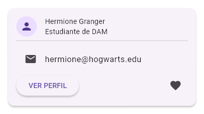

### 5.15 Flutter Inspector

Cuando la interfaz crece, leer solo el código se hace difícil. **Flutter Inspector** (en VS Code o Android Studio, con la app en marcha) **muestra el árbol de widgets en vivo**. Una tarjeta como

```dart
Card(
  child: Padding(
    padding: EdgeInsets.all(16),
    child: Column(
      children: [
        Text('Laura Pérez'),
        Divider(),
        Row(children: [Icon(Icons.email), Text('laura@email.com')]),
      ],
    ),
  ),
)
```

se ve en el Inspector como:

```
Card
└── Padding
    └── Column
        ├── Text
        ├── Divider
        └── Row
            ├── Icon
            └── Text
```

Sirve para relacionar las tres representaciones, que es **una de las ideas más importantes de la UT**:

```
INTERFAZ VISUAL  ↕  ÁRBOL DE WIDGETS  ↕  CÓDIGO DART
```

*(Cómo abrirlo y sus funciones, paso a paso: [Apuntes de la UT2, sección 6](../UT2.Componentes-Resutilizables/Apuntes-UT2.md#6-flutter-inspector).)*

### 5.16 Idea importante: las restricciones del layout

En Flutter **el padre condiciona cuánto espacio puede ocupar su hijo**. Por eso poner `width: 200` no siempre da exactamente lo que esperas. La regla que resume el sistema de layout:

```
Las restricciones bajan  (el padre le dice al hijo: "puedes medir entre X e Y")
Los tamaños suben        (el hijo responde: "mido Z")
El padre coloca          (el padre decide dónde va el hijo)
```

Se verá a fondo cuando aparezcan los primeros problemas de tamaño u *overflow*.

### Actividad 1.6 · Layout de un perfil de alumno

*(Cuestionario "Construcción del layout de una interfaz". Código en `actividad_1.6/construccion_del_layout_de_una_interfaz/lib/main.dart`)*

```
Scaffold
├── appBar: AppBar ('LAYOUTS')
└── body: Container (margin 20, padding 24)
    └── Column
        ├── Row  ← cabecera
        │   ├── Icon (account_circle, 50)
        │   ├── SizedBox (width 16)
        │   ├── Column ('LAURA PÉREZ', 'Desarrollo de Interfaces')
        │   ├── Spacer()             ← empuja lo siguiente a la derecha
        │   └── Column ('2.ºDAM', Icon settings)
        ├── Card → SizedBox (alto 90) → Center → 'MI PROGRESO'
        ├── Text ('MIS MÓDULOS')
        ├── SizedBox (height 12)
        ├── Row  ← dos tarjetas a partes iguales
        │   ├── Expanded → Card → Column spaceEvenly (Icon phone_android 45, 'FLUTTER', '8 h')
        │   ├── SizedBox (width 16)
        │   └── Expanded → Card → Column spaceEvenly (Icon language 45, 'WEB', '12 h')
        ├── Card → SizedBox (alto 120) → Stack  ← capas superpuestas
        │   ├── Card → Center → Column ('RETO SEMANAL', 'Layout Flutter')
        │   └── Positioned (top 12, right 12) → Icon (star, 28)
        └── Row ('ANTERIOR', Spacer, 'SIGUIENTE')
```

Técnicas de la sesión 5 que aplica:

- **`Spacer()`** en la cabecera y en la fila final: empuja elementos a los extremos.
- **`Expanded` + `SizedBox`:** dos tarjetas del mismo ancho con un hueco en medio.
- **`MainAxisAlignment.spaceEvenly`** dentro de cada tarjeta, para repartir el icono y los textos.
- **`Card` + `SizedBox(height: ...)`:** tarjetas con un alto fijo.
- **`Stack` + `Positioned`:** la estrella en la esquina superior derecha del reto semanal.

> ➕ **Mejora posible:** el `Container` del `body` solo usa `margin` y `padding`. Según la advertencia de 5.13, un `Padding(padding: EdgeInsets.all(44), ...)` haría lo mismo, ya que 20 + 24 = 44 y no hay fondo ni borde que distinga margen de relleno.

### Actividad 1.12 · Varios (pantallas con layout)

*(Código en `actividad_1.12/varios/lib/`. Tres pantallas como `StatelessWidget` propio que repasan las sesiones 5 y 6.)*

**1.12.1 · Jornada tecnológica** (`JornadaTecnologica`): casi todos los widgets de layout en una sola pantalla.

```
Scaffold ('Jornada tecnológica')
└── Padding (16)
    └── Column
        ├── Row spaceBetween ('Programa de actividades', Icon info_outline)
        ├── Image.network (300 × 160, BoxFit.cover)
        ├── Row → Expanded → Card ('Charlas') · Expanded → Card ('Talleres')
        ├── SizedBox (240 × 80) → Card → Center ('Próxima Actividad: 10:30')
        ├── Wrap (spacing 8, runSpacing 8) → 6 Chip
        ├── Container (padding 16, margin top/bottom 8, color grey.shade200)
        └── Column stretch → 2 ElevatedButton a todo el ancho
```

> ✏️ **Corrección:** el texto del `Container` dice «Inscrpcion graturita»: es «Inscripción gratuita hasta completar el aforo».
>
> ⚠️ Con tantos elementos, en un móvil pequeño la `Column` puede desbordarse por abajo: se arregla envolviéndola en `SingleChildScrollView` (como la 1.12.3).

**1.12.2 · Mi entrada** (`EntradaEvento`): `Center` → `Card` → `Padding(20)` → `Column(mainAxisSize: min)` con icono `confirmation_number`, título «TECH DAY 2026», imagen, `Container` con la fecha y botón «CONFIRMAR ASISTENCIA». Repasa `mainAxisSize.min` para que la tarjeta mida lo justo.

> ⏳ **Pendiente (probable):** el código parece la base sin personalizar (el `Container` solo tiene `padding`, los textos y la imagen no llevan estilo). Si el ejercicio pedía darle aspecto, faltan las propiedades de la sesión 6 (`TextStyle`, `BoxDecoration`, `ClipRRect` en la imagen…).

**1.12.3 · Panel de control de una sala** (`PanelSala`): la pantalla se **divide en widgets propios** (`CabeceraSala`, `ControlTemperatura`, `ControlOcupacion`, `ControlIluminacion`), cada uno un `StatelessWidget` con constructor `const ...({super.key})`, y se apilan en una `Column` dentro de `SingleChildScrollView` (así se puede hacer *scroll* si no cabe).

```
PanelSala
└── Scaffold (AppBar blueGrey)
    └── Center → SingleChildScrollView → Column (min)
        ├── CabeceraSala         (Icon meeting_room + 'SALA DE REUNIONES' + 'Planta 2')
        ├── ControlTemperatura   (Card: '23 °C' + botones − / +)
        ├── ControlOcupacion     (Card: '12 personas' + Salida / Entrada)
        └── ControlIluminacion   (Card: 'Encendida/Apagada' + Encender / Apagar)
```

Los botones tienen `onPressed: () {}`: **todavía no hacen nada**. Es el ejemplo perfecto de lo que resuelve la sesión 7: para que el «+» suba la temperatura, `ControlTemperatura` tiene que pasar a `StatefulWidget` con `int temperatura = 23` y `setState(() { temperatura++; })`. `CabeceraSala` en cambio se queda `StatelessWidget` (no cambia nunca).

### Actividad 1.13 · Dibujar con layouts

*(Código en `actividad_1.13/dibujar_con_layouts/lib/`. Dibujos hechos solo con `Container`, `BoxDecoration`, `Row`/`Column`/`Stack` y `Expanded`.)*

| Ejercicio | Dibujo | Técnica |
|---|---|---|
| **1.13.1** | Semáforo | `Container` negro con `padding` 12 y esquinas de 18 → `Column(mainAxisSize: min)` con tres `Container` de 90 × 90 redondeados (`borderRadius` 90 = círculo) y `margin` para separarlos |
| **1.13.2** | Bandera francesa | `SizedBox(300 × 200)` → `Row` con tres `Expanded` → `Container` azul, blanco y rojo (tres franjas iguales) |
| **1.13.3** | Diana | `Stack(alignment: center)` con cuatro círculos de 240, 180, 120 y 60 (del mayor al menor: el último queda encima) |
| **1.13.4** | — | ⏳ Plantilla «TÍTULO DEL DIBUJO» sin hacer |
| **1.13.5** | — | ⏳ Plantilla «TÍTULO DEL DIBUJO» sin hacer |

```dart
// 1.13.1: una luz del semáforo
Container(
  width: 90,
  height: 90,
  decoration: BoxDecoration(
    color: Colors.red,
    borderRadius: BorderRadius.circular(90),   // radio ≥ la mitad del lado → círculo
  ),
  margin: EdgeInsets.only(bottom: 12),         // separación con la siguiente luz
)
```

> ➕ **Ampliación:** (1) para un círculo también vale `shape: BoxShape.circle` en el `BoxDecoration` (sin `borderRadius`); (2) en los tres ejercicios hay un `Center` dentro de otro `Center` que sobra; (3) en la diana, lo habitual es `Stack(alignment: Alignment.center, ...)`. El semáforo se usa en la UT2 para practicar con Flutter Inspector.

---

## Sesión 6 · Propiedades y personalización

Las **propiedades** permiten modificar el **aspecto** y algunas características de los widgets **sin cambiar la estructura** de la interfaz (el árbol sigue siendo el mismo).

### 6.1 Propiedades más utilizadas

| Widget | Propiedades | Ejemplo |
|---|---|---|
| `Text` | `style`, `textAlign` | `textAlign: TextAlign.center` |
| `TextStyle` | `fontSize`, `fontWeight`, `color` | `fontSize: 24` |
| `Icon` | `size`, `color` | `size: 50` |
| `Image` | `width`, `height`, `fit` | `fit: BoxFit.cover` |
| `Card` | `color`, `elevation`, `shape` | `elevation: 6` |
| `Container` | `width`, `height`, `decoration` | `width: 250` |
| `ElevatedButton` | `style` | `ElevatedButton.styleFrom(...)` |

### 6.2 Texto

```dart
Text(
  'Flutter',
  textAlign: TextAlign.center,
  style: TextStyle(
    fontSize: 24,
    fontWeight: FontWeight.bold,
    color: Colors.blue,
  ),
)
```

> ➕ **Ampliación:** otras propiedades de `TextStyle` que salen en las actividades: `letterSpacing` (espacio entre letras, 1.11.2) y `height` (interlineado: `height: 1.5`, 1.11.1).

### 6.3 Iconos

```dart
Icon(
  Icons.star,
  size: 50,
  color: Colors.orange,
)
```

### 6.4 Imágenes

```dart
Image.network(
  'https://...',
  width: 250,
  height: 150,
  fit: BoxFit.cover,
)
```

| `BoxFit` | Resultado |
|---|---|
| `contain` | Muestra la imagen **completa** (pueden quedar huecos) |
| `cover` | **Cubre** todo el espacio; puede **recortar** |
| `fill` | **Rellena** todo el espacio; puede **deformar** |

### 6.5 Botones

```dart
ElevatedButton(
  onPressed: () {},
  style: ElevatedButton.styleFrom(
    backgroundColor: Colors.blue,                                // fondo
    foregroundColor: Colors.white,                               // texto e icono
    side: BorderSide(color: Colors.yellow, width: 1),            // borde
    padding: EdgeInsets.symmetric(horizontal: 12, vertical: 6),  // relleno
    shape: RoundedRectangleBorder(
      borderRadius: BorderRadius.circular(8),                    // esquinas
    ),
  ),
  child: Text('CONTINUAR'),
)
```

> ➕ **Ampliación: `ElevatedButton.icon`.** Botón con icono y texto: en vez de `child` usa **`icon:`** y **`label:`** (`ElevatedButton.icon(icon: Icon(Icons.arrow_back), label: Text('Volver'), onPressed: ...)`). Lo usan la 1.11.1 y la 1.11.2.

### 6.6 `Card`

```dart
Card(
  color: Colors.blue.shade50,
  elevation: 6,                                     // sombra
  shape: RoundedRectangleBorder(
    borderRadius: BorderRadius.circular(16),        // esquinas redondeadas
  ),
  child: Text('Flutter'),
)
```

### 6.7 `Container` y `BoxDecoration`

`Container` es útil cuando hay que personalizar una caja **combinando varias características**:

```dart
Container(
  width: 250,
  height: 120,
  decoration: BoxDecoration(
    color: Colors.blue,                         // fondo
    borderRadius: BorderRadius.circular(16),    // esquinas
    border: Border.all(                         // borde
      color: Colors.black,
      width: 2,
    ),
    // shape: BoxShape.circle,                  // o forma circular (ver la corrección)
  ),
  child: Text('Flutter'),
)
```

> ✏️ **Corrección:** el ejemplo del temario pone a la vez `borderRadius` y `shape: BoxShape.circle`. **No se pueden combinar**: con `shape: BoxShape.circle`, Flutter da error si también hay `borderRadius` (un círculo no tiene esquinas). Usa uno u otro.
>
> ⚠️ Si usas `decoration`, el color va **dentro** del `BoxDecoration`. Poner a la vez `color:` en el `Container` y `decoration:` da error. (La 1.12.1 usa `color:` sin `decoration`, que es correcto.)

### 6.8 `ClipRRect`

**`ClipRRect`** (*Clip Rounded Rectangle*) **recorta** un widget y su contenido siguiendo un rectángulo con **esquinas redondeadas**. Se usa mucho con imágenes, pero vale para cualquier widget (`Container`, `Column`, `Text`…):

```dart
ClipRRect(
  borderRadius: BorderRadius.circular(20),
  child: Image.network(
    'https://picsum.photos/400/200',
    width: 280,
    height: 140,
    fit: BoxFit.cover,
  ),
)
```

Aquí recorta las cuatro esquinas de la imagen con un radio de 20 píxeles. (Una imagen no tiene `borderRadius` propio: por eso hace falta envolverla.)

### 6.9 Colores

**Predefinidos:**

```dart
Colors.blue
Colors.red
Colors.orange
Colors.blue.shade100     // tonos: shade50 (más claro) … shade900 (más oscuro)
```

**Hexadecimal:** el `#2C3E50` de diseño se escribe `Color(0xFF2C3E50)`. Los dos primeros dígitos (`FF`) son la **opacidad** (`FF` = opaco, `00` = transparente); después van rojo, verde y azul.

```dart
Color(0xFF2C3E50)   // #2C3E50 opaco
```

> ➕ **Ampliación:** en la 1.7 se escribe `Color(0xff121212)`: las letras hexadecimales valen igual en minúscula o mayúscula.

### 6.10 ¿Qué propiedad necesito?

| Quiero modificar… | Utilizo… |
|---|---|
| Tamaño del texto | `fontSize` |
| Negrita | `fontWeight` |
| Color | `color` |
| Tamaño de un icono | `size` |
| Tamaño de una imagen | `width`, `height` |
| Ajuste de una imagen | `fit` |
| Fondo de un botón | `backgroundColor` |
| Texto/icono de un botón | `foregroundColor` |
| Sombra/elevación de una `Card` | `elevation` |
| Esquinas redondeadas | `borderRadius` |
| Borde | `border` |
| Decoración de una caja | `decoration` |

> **No hace falta memorizar todas las propiedades.** Lo importante es identificar **qué widget** quieres modificar y buscar **qué propiedad** controla esa característica (el autocompletado de VS Code, **Ctrl + Espacio**, ayuda mucho).

### Actividad 1.7 · Personalización de interfaces (reproductor «Night Drive»)

*(Cuestionario "Personalización de interfaces con Flutter". Código en `actividad_1.7/personalizacion_de_interfaces_con_flutter/lib/main.dart`)*

```
MaterialApp (debugShowCheckedModeBanner: false)
└── Scaffold (backgroundColor 0xff121212: fondo casi negro)
    └── Padding (24)
        └── Column (center)
            ├── Icon (headphones, 60, ámbar 0xffffb703)
            ├── SizedBox (20)
            ├── Text 'NIGHT DRIVE'        (28, blanco, negrita)
            ├── Text 'The Midnight Waves' (14, gris)
            ├── SizedBox (30)
            ├── Card (color 0xff1e1e1e, elevation 8, esquinas 20)
            │   └── Padding (20) → Row spaceEvenly
            │       ├── Icon skip_previous (36, blanco)
            │       ├── Icon play_circle   (64, ámbar)
            │       └── Icon skip_next     (36, blanco)
            ├── SizedBox (30)
            └── ElevatedButton → Text 'AÑADIR A FAVORITOS' (negro, negrita)
```

Aplica `TextStyle` (`fontSize`, `fontWeight`, `color`), colores hexadecimales, `Icon` con `size` y `color`, `Card` con `elevation` y `RoundedRectangleBorder`, `Padding`, `SizedBox` y `MainAxisAlignment` (`center` y `spaceEvenly`). **`debugShowCheckedModeBanner: false`** quita la cinta «DEBUG» de la esquina.

> ➕ **Mejora posible:** el color del botón se cambia desde el texto (`TextStyle(color: Colors.black)`). Lo propio de la sesión 6 es `style: ElevatedButton.styleFrom(backgroundColor: Color(0xffffb703), foregroundColor: Colors.black)`, que además colorea el fondo del botón a juego con el icono.

---

## Sesión 7 · Eventos, callbacks y gestión del estado

### 7.1 Eventos y callbacks

Los **eventos** permiten que la app **responda a las acciones del usuario**:

```
USUARIO → realiza una acción → EVENTO → CALLBACK → se ejecuta código
```

- **Evento:** algo que ocurre (pulsar, escribir, tocar…).
- **Callback:** la **función** que se ejecuta cuando ocurre.
- **Parámetro:** el dato que Flutter puede pasarle al callback.

### 7.2 `onPressed`: pulsar un botón

```dart
ElevatedButton(
  onPressed: () {
    print('Botón pulsado');
  },
  child: Text('GUARDAR'),
)
```

```
Pulsar GUARDAR → onPressed → () { ... } (callback) → "Botón pulsado"
```

`onPressed` **no proporciona ningún dato**: sus paréntesis van vacíos `()`.

### 7.3 `onChanged`: cada vez que cambia un valor

En un `TextField` (campo de texto):

```dart
TextField(
  onChanged: (String texto) {
    print(texto);
  },
)
```

Si escribimos «Sol», se ejecuta **tres veces**: `S`, `So`, `Sol`.

**¿De dónde sale `texto`?** Flutter le pasa al callback **el contenido nuevo** del `TextField`:

```
Usuario escribe → Flutter → "Sol" → (String texto) → print(texto)
```

`texto` es un **parámetro** y **el nombre lo elegimos nosotros**: `(String texto)`, `(String valor)` o `(String dato)` funcionan igual. **Flutter decide qué dato proporciona; nosotros elegimos cómo se llama.**

### 7.4 `onSubmitted`: al confirmar el texto

```dart
TextField(
  onSubmitted: (String texto) {
    print(texto);
  },
)
```

| Callback | ¿Cuándo se ejecuta? |
|---|---|
| `onChanged` | **Cada vez** que cambia el texto (letra a letra) |
| `onSubmitted` | Cuando el usuario **confirma** el texto (Intro / botón ✓ del teclado) |

### 7.5 `onTap`: tocar un elemento

```dart
ListTile(
  title: Text('Mi perfil'),
  onTap: () {
    print('Perfil seleccionado');
  },
)
```

Tampoco recibe datos: `()`.

### 7.6 Con parámetros y sin parámetros

```dart
// Sin datos
onPressed: () { ... }
onTap: () { ... }

// Con datos
onChanged: (String texto) { ... }
onSubmitted: (String texto) { ... }
```

| Callback | Recibe | Ejemplo |
|---|---|---|
| `onPressed` | Nada | `()` |
| `onTap` | Nada | `()` |
| `onChanged` de `TextField` | El texto nuevo | `(String texto)` |
| `onSubmitted` de `TextField` | El texto confirmado | `(String texto)` |
| `onChanged` de `Switch` ➕ | El nuevo `bool` | `(bool nuevoValor)` |
| `onChanged` de `Slider` ➕ | El nuevo `double` | `(double nuevoValor)` |

```
Por ahora:      EVENTO → CALLBACK → print()
Más adelante:   EVENTO → CALLBACK → cambia la interfaz (ESTADO)
```

### 7.7 Gestión del estado: crear nuestros propios widgets

Hasta ahora toda la interfaz estaba dentro de `main()`. Sirve para empezar, pero no es lo habitual: a medida que la app crece, **se divide en widgets más pequeños y organizados**:

```
MiApp
├── Cabecera
├── PerfilUsuario
├── Contenido
└── PiePagina
```

Flutter permite **crear nuestros propios widgets** con dos tipos de clase:

| `StatelessWidget` | `StatefulWidget` |
|---|---|
| Su contenido **no necesita cambiar** durante su uso | Su contenido **puede cambiar** durante su uso |
| Ejemplo: una cabecera | Ejemplo: un panel con un contador |

```
Widget
├── StatelessWidget   → interfaz sin cambios
└── StatefulWidget    → interfaz con cambios
```

### 7.8 `StatelessWidget`

Un widget propio cuyo contenido **no cambia**. Por ejemplo, una cabecera:

```dart
class Cabecera extends StatelessWidget {
  @override
  Widget build(BuildContext context) {
    return Column(
      children: [
        Icon(Icons.school),
        Text('Desarrollo de Interfaces'),
        Text('2.º DAM'),
      ],
    );
  }
}
```

Ahora se usa como cualquier otro widget: `body: Cabecera()`.

| Código | Significado |
|---|---|
| `class Cabecera` | Creamos una clase llamada `Cabecera` |
| `extends StatelessWidget` | `Cabecera` **hereda** de `StatelessWidget` y se convierte en un widget creado por nosotros |
| `@override` | **Redefinimos** un método heredado (el método `build`) |
| `build()` | **Construye la interfaz** del widget: le dice a Flutter qué tiene que dibujar |
| `BuildContext context` | Información sobre la **posición del widget en el árbol** |
| `return` | **Devuelve el árbol de widgets** que se mostrará |

> ➕ **Ampliación:** el código generado por Flutter y la UT2 añaden un **constructor** `const Cabecera({super.key});`. Sin él también funciona (Dart crea uno por defecto), pero con él puedes escribir `const Cabecera()` y el analizador deja de avisar. Se explica en la UT2.

#### Ejercicios 1.9.1 a 1.9.3 · Sacar partes de la interfaz a `StatelessWidget`

*(Código en `actividad_1.9/gestionar_estados/lib/`)*

| Ejercicio | Tarea | Estado |
|---|---|---|
| **1.9.1** | Crear `MiApp` como `StatelessWidget`, mover la interfaz a su `build()` y hacer que `main()` ejecute `runApp(MiApp())` | ✅ |
| **1.9.2** | Crear `PiePagina` con los dos textos del pie (`© 2026 Laura García` y `2.º DAM`) y usar `PiePagina()` en la interfaz | ⏳ sin hacer |
| **1.9.3** | Crear `Perfil` (icono, nombre y puesto) y `Contacto` (correo y teléfono) y usarlos en la interfaz principal | ⏳ sin hacer |

<details>
<summary>Solución propuesta de la 1.9.2 y la 1.9.3</summary>

```dart
// 1.9.2: el pie de página como widget propio
class PiePagina extends StatelessWidget {
  @override
  Widget build(BuildContext context) {
    return Column(
      children: [
        Text('© 2026 Laura García'),
        Text('2.º DAM'),
      ],
    );
  }
}

// En MiApp, dentro de la Column, los dos Text del pie se sustituyen por:
//   PiePagina(),
```

```dart
// 1.9.3: dos widgets y la interfaz principal queda en tres líneas
class Perfil extends StatelessWidget {
  @override
  Widget build(BuildContext context) {
    return Column(
      children: [
        Icon(Icons.account_circle, size: 80),
        Text('Mario Hernández'),
        Text('Desarrollador Flutter'),
      ],
    );
  }
}

class Contacto extends StatelessWidget {
  @override
  Widget build(BuildContext context) {
    return Column(
      children: [
        Icon(Icons.email),
        Text('mario@email.com'),
        Icon(Icons.phone),
        Text('600 123 456'),
      ],
    );
  }
}

// body: Column(children: [Perfil(), Divider(), Contacto()]),
```

</details>

### 7.9 ¿Y si la interfaz tiene que cambiar? El estado

Queremos un contador:

```
Contador: 0   →   [ SUMAR ]   →   Contador: 1   →   Contador: 2 …
```

Aparece un concepto nuevo: el **estado** = **información que puede cambiar durante la ejecución y cuyo valor afecta a la interfaz**.

| Estado | Tipo | Puede provocar… |
|---|---|---|
| `contador = 0` | `int` | Mostrar otro número |
| `favorito = false` | `bool` | ♡ → ♥ |
| `notificaciones = true` | `bool` | Activar/desactivar un `Switch` |
| `volumen = 50` | `double` | Mover un `Slider` |

> ⚠️ **No todas las variables son estado.** Una variable es estado de la interfaz cuando **puede cambiar** **y** ese cambio **afecta a la interfaz**. La pregunta es: *si cambia este dato, ¿debería cambiar algo en pantalla?*

#### Ejercicio 1.9.4 · El contador no puede vivir en un `StatelessWidget`

El código de partida declara `int contador = 0;` **dentro de `build()`** de un `StatelessWidget`: cada vez que Flutter reconstruye, vuelve a valer 0. **Tarea:** convertir `Contador` en `StatefulWidget`, crear su estado y mover el contador y el `build()` a la clase de estado. ⏳ Sin hacer (es justo el código de 7.10).

### 7.10 `StatefulWidget`

Cuando hay que **guardar un estado que cambia y actualizar la interfaz**, se usa `StatefulWidget`, que necesita **dos clases**:

```dart
class Contador extends StatefulWidget {
  @override
  State<Contador> createState() {
    return _ContadorState();
  }
}

class _ContadorState extends State<Contador> {
  int contador = 0;

  @override
  Widget build(BuildContext context) {
    return Text('$contador');
  }
}
```

- **`Contador`** (hereda de `StatefulWidget`) **define el widget** y sobrescribe `createState()` para **crear su objeto de estado**, `_ContadorState`.
- **`_ContadorState`** (hereda de `State<Contador>`) **guarda los datos que cambian** y **construye la interfaz** con ellos en su `build()`.

| Código | ¿Qué significa? |
|---|---|
| `class Contador` | Clase creada por nosotros |
| `extends StatefulWidget` | `Contador` hereda de `StatefulWidget` |
| `createState()` | Crea el objeto `State` asociado al widget |
| `_ContadorState` | Clase de estado creada por nosotros |
| `_` | El elemento es **privado** dentro de su biblioteca (su archivo) |
| `extends State<Contador>` | `_ContadorState` hereda del `State` asociado a `Contador` |
| `<Contador>` | Indica que ese `State` trabaja con un widget de tipo `Contador` |
| `int contador = 0` | Dato que forma parte del estado |
| `build()` | Construye la interfaz usando el estado |

**Genéricos:** lo que va entre `< >` indica **el tipo concreto** con el que trabaja la clase. Saldrá mucho en Dart:

```
State<Contador>  → State asociado a Contador
List<String>     → lista de String
List<int>        → lista de int
```

No hace falta dominarlos todavía (en Java son los mismos genéricos de `List<Producto>`).

> ➕ **Ampliación:** Flutter suele escribir `createState()` con **función flecha** (sesión 8): `State<Contador> createState() => _ContadorState();` es lo mismo que el `return` de arriba.

### 7.11 `setState()`

**Cambiar una variable no basta para actualizar la pantalla.** Para avisar a Flutter de que el estado ha cambiado:

```dart
setState(() {
  contador++;
});
```

`setState()` hace que Flutter **vuelva a ejecutar `build()`** y la interfaz se actualice:

```
USUARIO → EVENTO → CALLBACK → setState() → CAMBIA EL ESTADO → build() → INTERFAZ ACTUALIZADA
```

```dart
ElevatedButton(
  onPressed: () {
    setState(() {
      contador++;
    });
  },
  child: Text('Sumar'),
)
```

```
contador = 0 → SUMAR → setState() → contador = 1 → build() → se muestra 1
```

> ⚠️ **No escribas** `contador++; setState(() {});`. Funciona, pero los datos del estado deben **modificarse dentro de `setState()`**: así queda claro **qué variables cambian** en esa actualización. Ahora es una; imagínate cuando sean diez.

### 7.12 Ejemplo completo: el contador

```dart
class Contador extends StatefulWidget {
  @override
  State<Contador> createState() {
    return _ContadorState();
  }
}

class _ContadorState extends State<Contador> {
  int contador = 0;

  @override
  Widget build(BuildContext context) {
    return Column(
      children: [
        Text('Contador: $contador'),
        ElevatedButton(
          onPressed: () {
            setState(() {
              contador++;
            });
          },
          child: Text('Sumar'),
        ),
      ],
    );
  }
}
```

| Pieza | En el ejemplo |
|---|---|
| `StatefulWidget` | `Contador` |
| `State` | `_ContadorState` |
| Estado | `contador` |
| Evento | `onPressed` |
| Callback | `() { ... }` |
| Actualización | `setState()` |
| Interfaz | `build()` |

#### Ejercicios 1.9.5 a 1.9.9 · Que el cambio se vea en pantalla

Todos parten de código que **cambia la variable pero no llama a `setState()`** (o que ni siquiera la cambia). ⏳ En el repo siguen sin resolver.

| Ejercicio | Partida | Tarea |
|---|---|---|
| **1.9.5** | `onPressed: () { contador++; }` | Que el contador actualice la interfaz |
| **1.9.6** | `Switch` cuyo `onChanged` solo hace `print(nuevoValor)` | Guardar el nuevo valor y que el `Switch` se mueva |
| **1.9.7** | `nombre` y `visitas`; el botón hace `visitas++` | Que **solo** el cambio de `visitas` actualice (no hace falta tocar `nombre`) |
| **1.9.8** | `favorito` con `Icon` y `Text` que usan el ternario `favorito ? ... : ...` | Que cada pulsación invierta `favorito` y cambien el icono y el texto |
| **1.9.9** | `LogoCentro` y `ContadorAlumnos`, los dos `StatelessWidget` | Dejar `LogoCentro` como está y convertir `ContadorAlumnos` en `StatefulWidget` con su contador |

<details>
<summary>Solución propuesta (solo las líneas que cambian)</summary>

```dart
// 1.9.5
onPressed: () {
  setState(() {
    contador++;
  });
},

// 1.9.6: sin esto el Switch "rebota", porque su value sigue siendo el viejo
onChanged: (bool nuevoValor) {
  setState(() {
    notificaciones = nuevoValor;
  });
},

// 1.9.7: nombre no cambia, así que es un dato pero NO estado que actualizar
onPressed: () {
  setState(() {
    visitas++;
  });
},

// 1.9.8: ! invierte el bool (false → true → false…)
onPressed: () {
  setState(() {
    favorito = !favorito;
  });
},
```

```dart
// 1.9.9: LogoCentro sigue igual (StatelessWidget)
class ContadorAlumnos extends StatefulWidget {
  @override
  State<ContadorAlumnos> createState() {
    return _ContadorAlumnosState();
  }
}

class _ContadorAlumnosState extends State<ContadorAlumnos> {
  int alumnos = 0;

  @override
  Widget build(BuildContext context) {
    return Column(
      children: [
        Text('Alumnado presente: $alumnos'),
        ElevatedButton(
          onPressed: () {
            setState(() {
              alumnos++;
            });
          },
          child: Text('Añadir'),
        ),
      ],
    );
  }
}
```

</details>

> ➕ **Ampliación: el operador ternario** `condición ? siVerdadero : siFalso` es la forma de elegir **qué mostrar según el estado** dentro de `build()`: `Icon(favorito ? Icons.favorite : Icons.favorite_border)`. Es justo la idea de `INTERFAZ = f(estado)` de la sesión 1, y lo exige la práctica 1.10.

### 7.13 Otros ejemplos de estado: `Slider` y `Switch`

```dart
double volumen = 50;                    bool notificaciones = true;

Slider(                                 Switch(
  value: volumen,                         value: notificaciones,
  min: 0,                                 onChanged: (bool nuevoValor) {
  max: 100,                                 setState(() {
  onChanged: (double nuevoValor) {            notificaciones = nuevoValor;
    setState(() {                           });
      volumen = nuevoValor;               },
    });                                 )
  },
)
```

Aunque cambie el tipo de dato o el widget, **el mecanismo es siempre el mismo**:

```
EVENTO → CALLBACK → setState() → ESTADO → build() → INTERFAZ
```

#### Ejercicio 1.9.10 · Ajustes visuales ✅

`AjustesVisuales` (`StatefulWidget`) con `bool modoOscuro = false` y `double tamanoTexto = 16`: un `Switch` actualiza `modoOscuro`, un `Slider` (12 a 30) actualiza `tamanoTexto` y el `Text` de ejemplo usa `style: TextStyle(fontSize: tamanoTexto)`, así que crece y encoge al mover el slider.

> ⏳ **Pendiente:** `modoOscuro` cambia pero **todavía no se usa** en la interfaz. Para que se note, por ejemplo: envolver la `Column` en `Container(color: modoOscuro ? Colors.black : Colors.white, ...)` y dar al texto `color: modoOscuro ? Colors.white : Colors.black`.

### 7.14 ¿`StatelessWidget` o `StatefulWidget`?

| Si el widget… | Utilizamos |
|---|---|
| Solo muestra información | `StatelessWidget` |
| No mantiene estado propio que cambie | `StatelessWidget` |
| Mantiene un dato que cambia | `StatefulWidget` |
| Y ese cambio debe reflejarse en pantalla | `StatefulWidget` |

**Tener un botón no significa necesitar un `StatefulWidget`.** La pregunta es: *¿necesito guardar un dato que cambia y ese cambio debe verse en la interfaz?*

```
¿La interfaz depende de un estado que cambia?
              ┌──────┴──────┐
             NO             SÍ
              ↓              ↓
       StatelessWidget  StatefulWidget
```

### Actividad 1.10 · Tarjeta de presentación

*(Enunciado en `actividad_1.10/tarjeta_de_presentacion/tarjeta_de_presentacion/ACTIVIDAD.md`. Se entrega `main.dart`.)*

App con una **tarjeta de presentación** que se actualiza **mientras escribes**, sin botones de confirmar:

- `TextField` de **nombre** y de **profesión**, que actualizan la tarjeta en tiempo real.
- Si están vacíos: «Tu nombre» y «Tu profesión».
- Mensaje inferior: «Completa tus datos» si el nombre está vacío y «Tarjeta personalizada» si tiene texto.
- `Switch` de **modo oscuro** que cambia fondo, tarjeta, textos e icono.

| Elemento | Propiedades |
|---|---|
| Fondo claro / oscuro | `Color(0xFFF2F5F9)` / `Color(0xFF202B3A)` |
| Tarjeta clara / oscura | `Colors.white` / `Color(0xFF36455B)` |
| Márgenes exteriores | 16 px |
| Separación principal | 20 px |
| Título | 24 px, negrita |
| Nombre | 22 px, negrita |
| Profesión | 16 px |
| Mensaje inferior | 12 px |
| Icono | `Icons.person`, 55 px (en modo claro, `Color(0xFF315D95)`) |
| Elevación de la tarjeta | 3 |
| Textos | `Colors.black87` / `Colors.black54` en claro · `Colors.white` / `Colors.white70` en oscuro |

**Requisitos:** un widget propio `StatefulWidget` con su clase de estado; variables para nombre, profesión y modo; **`onChanged` + `setState()`**; **operador ternario** para textos y colores; **sin `TextEditingController`** ni otros mecanismos de estado.

**Cómo se resuelve con lo de esta sesión** (piezas, no la práctica entera):

```dart
// Estado: tres variables en la clase State
String nombre = '';
String profesion = '';
bool modoOscuro = false;

// Evento → callback → setState()
TextField(
  decoration: InputDecoration(labelText: 'Nombre'),   // ➕ etiqueta del campo
  onChanged: (String texto) {
    setState(() {
      nombre = texto;
    });
  },
)

// Interfaz = f(estado), con ternarios
Text(nombre.isEmpty ? 'Tu nombre' : nombre)
Text(nombre.isEmpty ? 'Completa tus datos' : 'Tarjeta personalizada')
Scaffold(backgroundColor: modoOscuro ? Color(0xFF202B3A) : Color(0xFFF2F5F9), ...)
```

> ⏳ **Pendiente:** en el repo, `lib/main.dart` (y la copia de la subcarpeta `tarjeta_de_presentacion/tarjeta_de_presentacion/`) siguen siendo el **contador de plantilla** de Flutter. Además hay un proyecto duplicado dentro de otro: conviene dejar solo uno.

---

## Sesión 8 · Navegación entre pantallas

### 8.1 Una pantalla también es un widget

Las apps no suelen tener una sola pantalla: inicio, catálogo, detalle de un producto, configuración… En Flutter **una pantalla es un widget más**, así que no hay que aprender nada nuevo para construirlas: normalmente **cada pantalla es una clase que devuelve un `Scaffold`**.

```dart
class PantallaInicio extends StatelessWidget {
  const PantallaInicio({super.key});

  @override
  Widget build(BuildContext context) {
    return Scaffold(
      appBar: AppBar(title: const Text('Inicio')),
      body: const Center(child: Text('Esta es la pantalla principal')),
    );
  }
}

class PantallaDetalles extends StatelessWidget {
  const PantallaDetalles({super.key});

  @override
  Widget build(BuildContext context) {
    return Scaffold(
      appBar: AppBar(title: const Text('Detalles')),
      body: const Center(child: Text('Esta es la pantalla de detalles')),
    );
  }
}
```

Son dos pantallas independientes: falta la forma de **moverse entre ellas**. Para eso está **`Navigator`**.

> Una pantalla **no necesita ser `StatefulWidget` por permitir navegar**. Si no guarda información que cambia, sigue siendo `StatelessWidget`.

### 8.2 `Navigator` y la pila de navegación

**`Navigator`** es el componente de Flutter que **gestiona la navegación** entre pantallas, y funciona como una **pila** (*stack*). Si el usuario entra en Inicio, abre Productos y después el detalle de un producto:

```
┌───────────────────────┐
│ Detalles del producto │  ← pantalla visible (cima)
├───────────────────────┤
│ Productos             │
├───────────────────────┤
│ Inicio                │
└───────────────────────┘
```

Cada pantalla nueva se coloca **encima**; al volver, se **retira la de arriba** y se ve la de debajo. Es un comportamiento **LIFO** (*Last In, First Out*: el último en entrar es el primero en salir), el mismo de la pila de llamadas que se ve en Servicios y Procesos.

| Operación | Función |
|---|---|
| `Navigator.push()` | **Añade** una ruta nueva a la pila |
| `Navigator.pop()` | **Retira** la ruta de arriba |

### 8.3 Abrir una pantalla con `Navigator.push()`

```dart
Navigator.push(
  context,
  MaterialPageRoute(
    builder: (context) => const PantallaDetalles(),
  ),
);
```

| Elemento | Función |
|---|---|
| **Ruta** (*route*) | Objeto que representa **una entrada de la navegación**: qué contenido se muestra y cómo se presenta |
| `Navigator` | Widget que gestiona una **pila de rutas** (`push()` añade, `pop()` retira) |
| `context` | Permite **localizar el `Navigator`** dentro del árbol de widgets |
| `MaterialPageRoute` | Crea una ruta cuyo contenido se construye con una función `builder`, con las **transiciones de Material Design** |
| `builder` | **Construye** el widget de la nueva pantalla |
| `PantallaDetalles()` | El widget de la **pantalla de destino** |

**¿Por qué hay que localizar el `Navigator`?** Porque una app puede tener **varios**. `MaterialApp` crea uno por defecto (el **raíz**), que es el que usaremos por ahora, pero el desarrollador puede crear otros (por ejemplo, uno por pestaña):

```
MaterialApp
└── Navigator raíz (automático)
    └── PantallaPrincipal
        ├── SeccionInicio
        │   └── Navigator A (creado por nosotros)
        │       └── PantallaInicio
        └── SeccionPerfil
            └── Navigator B (creado por nosotros)
                └── PantallaPerfil
```

Con `context` Flutter sabe **en qué lugar del árbol estamos** y busca el `Navigator` más cercano hacia arriba.

**Las funciones flecha (`=>`).** Son la forma abreviada de una función cuyo cuerpo es **una sola expresión**: `=>` sustituye a las llaves y al `return`.

```dart
// Función tradicional                 // Función flecha
int doble(int numero) {                int doble(int numero) => numero * 2;
  return numero * 2;
}
```

```dart
// Tradicional                                  // Flecha (la que se usa siempre)
MaterialPageRoute(                              MaterialPageRoute(
  builder: (context) {                            builder: (context) => const PantallaDetalles(),
    return const PantallaDetalles();            )
  },
)
```

| Elemento | Significado |
|---|---|
| `builder` | Propiedad que **recibe una función** |
| `(context)` | Parámetro que recibe la función |
| `=>` | La función **devuelve** el resultado de la expresión de su derecha |
| `const PantallaDetalles()` | El widget que devuelve la función |

> ➕ **Ampliación:** es lo mismo que las *lambdas* de Java (`x -> x * 2`) y las funciones flecha de JavaScript (`x => x * 2`) de PMDM.

**Se usa dentro de un evento**, normalmente el `onPressed` de un botón:

```dart
ElevatedButton(
  onPressed: () {
    Navigator.push(
      context,
      MaterialPageRoute(
        builder: (context) => const PantallaDetalles(),
      ),
    );
  },
  child: const Text('Ver detalles'),
)
```

Para ir a otra pantalla basta con **cambiar el widget del `builder`**. La navegación es la respuesta a un evento, con los callbacks de la sesión 7.

### 8.4 Volver con `Navigator.pop()`

```dart
ElevatedButton(
  onPressed: () {
    Navigator.pop(context);   // retira la pantalla actual de la pila
  },
  child: const Text('Volver'),
)
```

Si la pantalla tiene `Scaffold` con `AppBar` y hay una ruta anterior, Flutter **añade automáticamente la flecha ←** en la barra. Así que se vuelve de dos formas, y las dos retiran la ruta actual:

- Con la **flecha de retroceso** del `AppBar` (o el botón «atrás» de Android).
- Con un **botón** que ejecute `Navigator.pop(context)`.

> ⚠️ `Navigator.pop()` **no significa «ir a Inicio»**: significa **volver a la ruta anterior**.
>
> ➕ **Ampliación:** para quitar la flecha automática del `AppBar` se pone `automaticallyImplyLeading: false` (lo usan la 1.11.1 y la 1.11.2, que tienen su propio botón de volver).

### 8.5 Sustituir con `Navigator.pushReplacement()`

`pushReplacement()` **sustituye la ruta actual por una nueva** en lugar de añadirla encima. Con el recorrido Inicio → Identificación → Bienvenida:

```
Con push():                       Con pushReplacement() desde Identificación:
┌────────────────┐                ┌────────────────┐
│ Bienvenida     │ ← actual       │ Bienvenida     │ ← actual
├────────────────┤                ├────────────────┤
│ Identificación │                │ Inicio         │
├────────────────┤                └────────────────┘
│ Inicio         │
└────────────────┘
«Atrás» → Identificación          «Atrás» → Inicio (Identificación ya no está)
```

```dart
Navigator.pushReplacement(
  context,
  MaterialPageRoute(builder: (context) => const PantallaBienvenida()),
);
```

Uso típico: una pantalla de **login** o de **carga** a la que no tiene sentido volver.

### 8.6 Volver varias pantallas con `Navigator.popUntil()`

A veces hay que retroceder **varias pantallas de golpe**. Con Inicio → Sala 1 → Sala 2 → Victoria:

```
┌──────────┐
│ Victoria │ ← visible
├──────────┤
│ Sala 2   │
├──────────┤
│ Sala 1   │
├──────────┤
│ Inicio   │
└──────────┘
```

`Navigator.pop(context)` volvería a Sala 2. **`Navigator.popUntil()`** retira rutas **hasta que se cumpla una condición**; con `route.isFirst` («es la primera de la pila») vuelve directamente a Inicio:

```dart
ElevatedButton(
  onPressed: () {
    Navigator.popUntil(
      context,
      (route) => route.isFirst,   // función flecha: ¿esta ruta es la primera?
    );
  },
  child: const Text('Volver al inicio'),
)
```

| Método | Pila antes | Pila después |
|---|---|---|
| `push(B)` | `[A]` | `[A, B]` |
| `pop()` | `[A, B]` | `[A]` |
| `pushReplacement(C)` | `[A, B]` | `[A, C]` |
| `popUntil(isFirst)` | `[A, B, C, D]` | `[A]` |

### 8.7 Ejemplo completo: navegación entre dos pantallas

```dart
import 'package:flutter/material.dart';

void main() {
  runApp(
    const MaterialApp(
      debugShowCheckedModeBanner: false,
      home: PantallaInicio(),
    ),
  );
}

// --------------------------------------------------
// PANTALLA DE INICIO
// --------------------------------------------------
class PantallaInicio extends StatelessWidget {
  const PantallaInicio({super.key});

  @override
  Widget build(BuildContext context) {
    return Scaffold(
      appBar: AppBar(title: const Text('Inicio')),
      body: Center(
        child: ElevatedButton(
          onPressed: () {
            Navigator.push(
              context,
              MaterialPageRoute(
                builder: (context) => const PantallaDetalles(),
              ),
            );
          },
          child: const Text('Ver detalles'),
        ),
      ),
    );
  }
}

// --------------------------------------------------
// PANTALLA DE DETALLES
// --------------------------------------------------
class PantallaDetalles extends StatelessWidget {
  const PantallaDetalles({super.key});

  @override
  Widget build(BuildContext context) {
    return Scaffold(
      appBar: AppBar(title: const Text('Detalles')),
      body: Center(
        child: Column(
          mainAxisSize: MainAxisSize.min,
          children: [
            const Text('¡Bienvenido a la segunda pantalla!'),
            const SizedBox(height: 20),
            ElevatedButton(
              onPressed: () {
                Navigator.pop(context);
              },
              child: const Text('Volver'),
            ),
          ],
        ),
      ),
    );
  }
}
```

### Actividad 1.11 · Navegación en Flutter

*(Código en `actividad_1.11/navegacion_en_flutter/lib/`)*

**1.11.1 · Catálogo de películas** ✅ (`PantallaCatalogo` + `PantallaInterstellar`, `PantallaJurassicPark`, `PantallaCoco`)

```
PantallaCatalogo
└── Scaffold
    └── ListView (padding 16)            ← lista con scroll
        ├── Card → ListTile (leading Icon, title, subtitle, trailing chevron_right, onTap → push)
        ├── Card → ListTile ...
        └── Card → ListTile ...
Pantalla<Película>
└── Scaffold (AppBar con automaticallyImplyLeading: false)
    └── Padding (24) → Column stretch
        ├── Icon (90) · título (28, negrita) · género y año · 'Sinopsis' · texto (height 1.5)
        └── ElevatedButton.icon ('Volver al catálogo') → pop
```

Lo nuevo:

- **`ListView`:** como una `Column`, pero con **scroll** cuando no cabe. Es lo normal para listas.
- **`onTap` del `ListTile`** con `Navigator.push` a la pantalla de cada película.
- **`MaterialApp`** con `title` y `theme: ThemeData(colorScheme: ColorScheme.fromSeed(seedColor: Colors.deepOrange))`: un **tema** genera toda la paleta de colores de la app a partir de un color.

> ➕ **Mejora posible:** las tres pantallas de película son **iguales salvo los datos**. Con lo de la UT2 se sustituyen por una sola `PantallaPelicula` con propiedades (`titulo`, `icono`, `genero`, `sinopsis`) y `builder: (context) => const PantallaPelicula(titulo: 'Coco', ...)`.

**1.11.2 · Misión Marte** ⏳ (6 pantallas en cadena: `CentroControl` → `Identificacion` → `Combustible` → `Oxigeno` → `Motores` → `Despegue`). Solo hay que completar los **TODO** de los botones (todos con `push`); cada pantalla usa `SafeArea`, `SingleChildScrollView` y `ConstrainedBox(maxWidth: 480)` para que el contenido no pase de 480 px de ancho en pantallas grandes.

| TODO | Botón | Código |
|---|---|---|
| 1 | INICIAR MISIÓN (Centro de control) | `Navigator.push(context, MaterialPageRoute(builder: (context) => const Identificacion()));` |
| 2 | → Combustible | `push(... const Combustible())` |
| 3 | → Oxígeno | `push(... const Oxigeno())` |
| 4 | → Motores | `push(... const Motores())` |
| 5 | → Despegue | `push(... const Despegue())` |
| — | INICIAR NUEVA MISIÓN (Despegue) | Ya viene escrito: `Navigator.pop(context);` (ver la corrección) |

> ✏️ **Corrección:** el comentario del archivo habla de «seis instrucciones TODO», pero solo hay **cinco**; el sexto botón, «INICIAR NUEVA MISIÓN», ya trae `Navigator.pop(context)`, que **solo vuelve a Motores**. Para empezar la misión desde el principio habría que volver al Centro de control con `Navigator.popUntil(context, (route) => route.isFirst);`.

**1.11.3 · Escape de Hogwarts** ⏳ (aventura con 9 escenas que comparten el widget `Escena`; 17 TODO). Cada TODO practica un método concreto de la pila:

| TODO | Acción | Método |
|---|---|---|
| 1, 2 | Gran Escalera → Biblioteca / Mazmorras | `push` |
| 3 | Examinar el Libro Prohibido («debes poder regresar») | `push` |
| 4 | Pasadizo Secreto («la Biblioteca desaparece de la pila») | `pushReplacement` |
| 5, 11 | Volver de la Biblioteca / Mazmorras a la Gran Escalera | `pop` |
| 6 | Cerrar el libro y volver a la Biblioteca | `pop` |
| 7 | Correr hacia la salida desde el Pasadizo («no sabes a dónde te lleva») | `push` a uno de los finales (lo lógico es `Escapaste`) |
| 8 | Escaleras de emergencia → Gran Escalera | `pop` (la Biblioteca ya no está debajo) o `popUntil(isFirst)` |
| 9 | Entrar en el despacho de Snape | `push` |
| 10 | Puerta Misteriosa («las Mazmorras desaparecen de la pila») | `pushReplacement` |
| 12 | Snape te descubre → «¡Atrapado!» | `push` (o `pushReplacement`) a `Atrapado` |
| 13 | Entrar en la Sala Secreta | `push` |
| 14 | Abrir la salida → «¡Escapaste!» | `push` |
| 15 | Volver de la Sala Secreta a la Puerta Misteriosa | `pop` |
| 16, 17 | Reiniciar desde un final y volver **directamente** a la Gran Escalera | `popUntil((route) => route.isFirst)` |

> 💡 Las frases «debes poder regresar» → `push`, «desaparece de la pila» → `pushReplacement`, «vuelve directamente» al principio → `popUntil`. Dibuja la pila en papel antes de cada TODO.

---

## Buenas costumbres (ampliación)

> ➕ **`const`:** si un widget no cambia nunca, ponle `const` delante: `const Text('Hola')`, `const SizedBox(height: 12)`. Flutter no lo vuelve a construir en cada repintado. El analizador lo sugiere subrayándolo en azul.
>
> ➕ **Coma final:** pon siempre `,` después del último parámetro. Así el formateador (`dart format`, o Shift+Alt+F en VS Code) coloca cada widget en su línea y el árbol se lee mucho mejor.
>
> ➕ **Hot Reload:** con la app en marcha, al guardar (Ctrl+S) los cambios aparecen al instante **sin perder el estado** (el contador sigue en su valor). **Hot Restart** reinicia la app y el estado vuelve al inicio.
>
> ➕ **Un widget por trozo de pantalla:** en cuanto un `build()` pase de una pantalla de largo, saca partes a widgets propios (1.12.3) y, en la UT2, a archivos propios.

---

## Chuleta de widgets

| Widget | Hijos | Para qué |
|---|---|---|
| `MaterialApp` | `home` | La app (Material Design, `theme`, `debugShowCheckedModeBanner`) |
| `Scaffold` | `appBar`, `body`, `floatingActionButton` | Estructura de una pantalla (`backgroundColor`) |
| `AppBar` | `title` | Barra superior (`automaticallyImplyLeading`) |
| `Text` | — | Texto (`style: TextStyle(...)`, `textAlign`) |
| `Icon` | — | Icono (`Icons.xxx`, `size`, `color`) |
| `Image.network` | — | Imagen de Internet (`width`, `height`, `fit: BoxFit...`) |
| `Divider` | — | Línea separadora |
| `ElevatedButton` | `child` | Botón (`onPressed`, `style: ElevatedButton.styleFrom(...)`) |
| `ElevatedButton.icon` | `icon`, `label` | Botón con icono y texto |
| `IconButton` | `icon` | Botón de solo icono |
| `CircleAvatar` | `child` | Círculo de perfil |
| `Card` | `child` | Tarjeta (`color`, `elevation`, `shape`) |
| `ListTile` | `leading`, `title`, `subtitle`, `trailing` | Fila con icono + título + subtítulo (`onTap`) |
| `ListView` | `children` | Lista con scroll |
| `Center` | `child` | Centrar |
| `Padding` | `child` | Espacio alrededor (`EdgeInsets`) |
| `SizedBox` | `child` (opcional) | Hueco fijo o tamaño fijo (`double.infinity`) |
| `Expanded` | `child` | Ocupar el espacio libre (`flex`) |
| `Flexible` | `child` | Como `Expanded`, pero sin obligar a ocuparlo todo (UT2) |
| `Spacer` | — | Espacio flexible |
| `Container` | `child` | Tamaño + margin + padding + `decoration: BoxDecoration(...)` |
| `ClipRRect` | `child` | Recortar con esquinas redondeadas |
| `Row` | `children` | Horizontal → |
| `Column` | `children` | Vertical ↓ (`mainAxisSize`) |
| `Stack` | `children` | Capas superpuestas |
| `Positioned` | `child` | Posición dentro de un `Stack` (`Positioned.fill`) |
| `Wrap` | `children` | Fila con salto de línea (`spacing`, `runSpacing`) |
| `Chip` | `label` | Etiqueta pequeña |
| `SingleChildScrollView` | `child` | Hacer scroll si el contenido no cabe |
| `TextField` | — | Campo de texto (`onChanged`, `onSubmitted`) |
| `Switch` | — | Interruptor (`value`, `onChanged(bool)`) |
| `Slider` | — | Deslizador (`value`, `min`, `max`, `onChanged(double)`) |

| Dart / Flutter | Para qué |
|---|---|
| `class X extends StatelessWidget` + `build()` | Widget propio que no cambia |
| `class X extends StatefulWidget` + `createState()` + `class _XState extends State<X>` | Widget propio con estado |
| `setState(() { ... })` | Cambiar el estado y redibujar |
| `cond ? a : b` | Elegir texto, icono o color según el estado |
| `(param) => expresión` | Función flecha |
| `Navigator.push / pop / pushReplacement / popUntil` | Navegar por la pila de pantallas |

---

## Preguntas para repasar

1. ¿Qué diferencia hay entre desarrollo **nativo** y **multiplataforma**? Di una ventaja de cada uno.
2. ¿Qué lenguaje usa Flutter? ¿Y React Native?
3. Explica la diferencia entre **imperativo** y **declarativo** con el ejemplo del modo oscuro. ¿Qué significa `INTERFAZ = f(estado)`?
4. ¿Qué hacen `main()`, `runApp()`, `MaterialApp` y `Scaffold`? ¿Cuál de ellos es de Dart y no de Flutter?
5. Una `Card` contiene una `Column` con 3 `Text`. ¿Usa `child` o `children`? ¿Por qué?
6. En una `Row`, ¿qué controla `crossAxisAlignment`: lo horizontal o lo vertical?
7. ¿Qué diferencia hay entre `spaceBetween`, `spaceAround` y `spaceEvenly`?
8. ¿Cuándo usarías `SizedBox` y cuándo `Spacer`?
9. Dos `Expanded` con `flex: 1` y `flex: 3`: ¿qué parte del espacio recibe cada uno?
10. ¿Por qué `Stack` usa `children` y `Positioned` usa `child`?
11. ¿Qué problema resuelve `Wrap` que `Row` no resuelve?
12. ¿Por qué no conviene usar `Container` cuando solo quieres centrar algo?
13. ¿Qué diferencia hay entre `BoxFit.contain`, `cover` y `fill`?
14. ¿Cómo se escribe el color `#FF8C5A` en Flutter? ¿Qué son los dos primeros dígitos?
15. ¿Por qué no puedes poner `borderRadius` y `shape: BoxShape.circle` a la vez?
16. ¿Qué diferencia hay entre `onChanged` y `onSubmitted` en un `TextField`? ¿Quién decide el nombre del parámetro `texto`?
17. ¿Qué es el estado? ¿Toda variable es estado?
18. ¿Para qué sirven las dos clases de un `StatefulWidget`? ¿Qué indica el `_` de `_ContadorState`?
19. ¿Qué pasa si haces `contador++` sin `setState()`?
20. Una pantalla tiene un botón que navega a otra. ¿Tiene que ser `StatefulWidget`?
21. ¿Qué diferencia hay entre `push`, `pushReplacement`, `pop` y `popUntil`?
22. ¿Por qué `Navigator.push` necesita `context`?
23. Reescribe `builder: (context) { return const PantallaDetalles(); }` con función flecha.

<details>
<summary>Soluciones</summary>

1. Nativo: una app por plataforma con su tecnología (aprovecha al máximo el sistema operativo, pero son dos códigos). Multiplataforma: un solo código para varias (se mantiene un único proyecto).
2. Flutter usa Dart. React Native, JavaScript/TypeScript.
3. Imperativo: escribes los cambios uno a uno. Declarativo: describes cómo es la interfaz para cada estado y el framework la actualiza. La interfaz depende solo del estado actual.
4. `main()`: punto de entrada (es de **Dart**). `runApp()`: arranca Flutter con un widget raíz. `MaterialApp`: configura la app (Material, `home`). `Scaffold`: estructura de una pantalla (`appBar`, `body`…).
5. `child`, porque su único hijo directo es la `Column`.
6. Lo vertical (en una `Row` el eje transversal es vertical).
7. `spaceBetween`: sin hueco en los bordes. `spaceAround`: hueco en los bordes igual a la mitad del hueco entre elementos. `spaceEvenly`: todos los huecos iguales, bordes incluidos.
8. `SizedBox` para un hueco de tamaño fijo. `Spacer` para ocupar todo el espacio sobrante y empujar elementos a los extremos.
9. 1/4 y 3/4 del espacio libre.
10. `Stack` organiza varios elementos superpuestos. Cada `Positioned` coloca uno solo.
11. El desbordamiento: cuando no caben en horizontal, `Wrap` pasa a la línea siguiente.
12. Porque `Center` expresa mejor la intención y es más sencillo de leer.
13. `contain`: imagen completa (puede dejar huecos). `cover`: cubre todo y puede recortar. `fill`: rellena todo y puede deformar.
14. `Color(0xFFFF8C5A)`. Los dos primeros (`FF`) son la opacidad.
15. Porque un círculo no tiene esquinas: Flutter da error si hay `borderRadius` con `BoxShape.circle`.
16. `onChanged` se ejecuta con cada cambio (letra a letra); `onSubmitted`, al confirmar. Flutter decide qué dato pasa; el nombre lo elegimos nosotros.
17. Información que puede cambiar durante la ejecución y cuyo cambio afecta a la interfaz. No: solo lo es si al cambiar debería cambiar algo en pantalla.
18. `Contador` define el widget y crea su estado con `createState()`; `_ContadorState` guarda los datos que cambian y construye la interfaz. El `_` lo hace privado dentro de su archivo.
19. La variable cambia, pero `build()` no se vuelve a ejecutar y la pantalla sigue igual.
20. No. Solo si guarda un dato que cambia y se tiene que ver en pantalla.
21. `push` añade una pantalla encima; `pushReplacement` sustituye la actual; `pop` retira la de arriba (vuelve a la anterior); `popUntil` retira hasta que se cumple una condición (p. ej. volver a la primera).
22. Para localizar el `Navigator` en el árbol de widgets (puede haber varios; por defecto, el que crea `MaterialApp`).
23. `builder: (context) => const PantallaDetalles(),`

</details>
